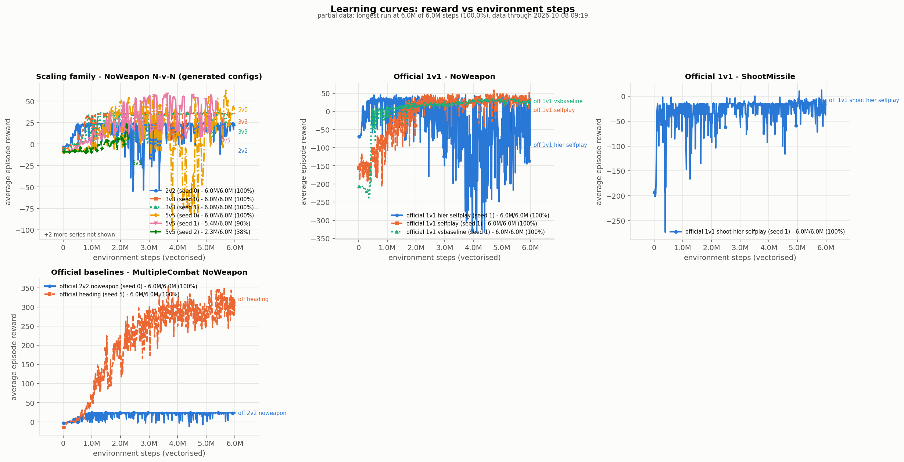
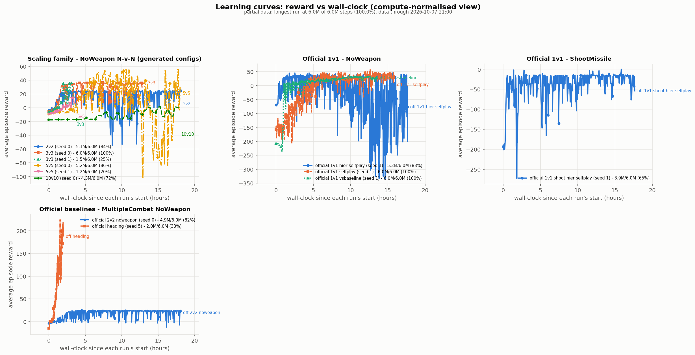
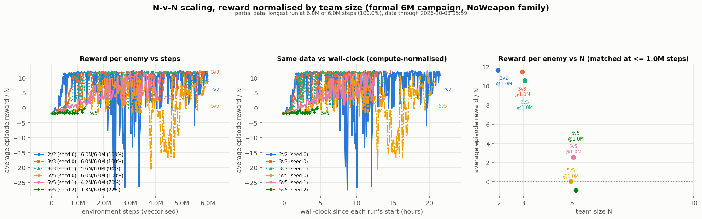
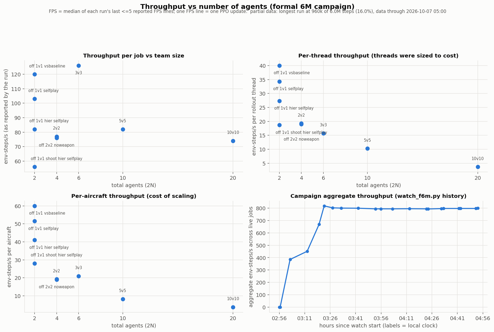
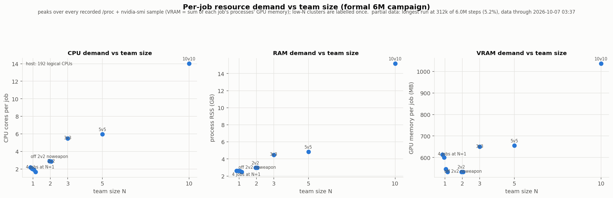
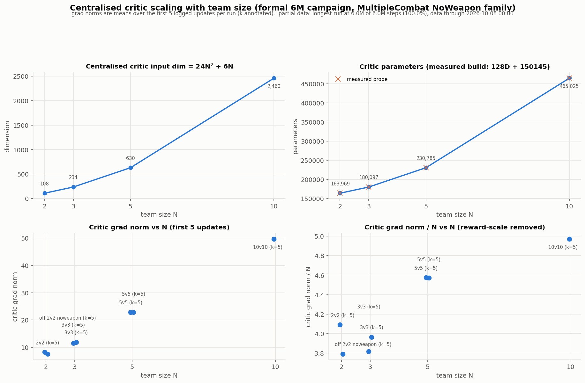

# SRTP 6M 正式复现与 scaling 报告

负责人：刘酝潇
实验窗口：2026-10-07 02:54 CST → 2026-10-08 10:00 CST
分支：`exp/formal-6m-20261007`
工作区：`experiments/2026-10-07-08-formal6m/`

> **状态：进行中（IN PROGRESS）。** 本文档在运行仍在训练期间持续更新。标记为
> 「待定」的数字尚不可用。本报告没有任何内容是从 §3 的 pilot（前序试跑）运行
> 外推来顶替正式数字的；某一正式数字尚不存在时，对应单元格会明确说明。
>
> §5–§8、§11、§12 与 §17 由数据派生，并由
> `experiments/2026-10-07-08-formal6m/scripts/fill_report.py` 就地重新生成：该
> 脚本精确重写这些章节中每一对 `<!-- AUTO:sectionN -->` /
> `<!-- /AUTO:sectionN -->` 标记之间的区域。不要在标记对内手工编辑——请修改
> 生成器或它读取的 CSV。其余章节为手写，生成器从不触碰。

---

## 1. 实验目标

本轮的目标不是"把官方实验跑满"，而是在约 **31 小时**的有限挂钟时间（wall-clock）
预算内，最大化 **科研信息量 / 计算成本**，产出一套可复现、口径统一的数据体系：

1. **实验线 A — 官方 baseline 的 6M 正式复现。**
   对仓库中**真实存在**的官方入口，在保持全部官方超参数不变的前提下，
   把训练预算从 `1e8` 降到 `6e6`，得到一条比 §3 的 ~1M pilot 可信得多的学习曲线。
2. **实验线 B — N-v-N 可扩展性（scalability）。** 对 N ∈ {2,3,5,10} 的 NoWeapon
   任务，在**同一个 6M environment-step 预算**下训练，得到一条 vanilla
   baseline scaling 曲线。
3. **关键的第二个种子**，用于把"单种子趋势"升级为"可分离噪声的观察"。
4. **两条比较轴**：等样本（equal-sample，相同 env steps）与等挂钟时间
   （equal-wall-clock，相同小时数）。因为 10v10 的计算开销本身就是可扩展性
   问题的一部分。

**本轮明确不做**：不实现 Graph/Attention/Hypergraph/World-Model/Locality-MAPPO，
不修改 reward / 网络 / 超参数，不做 observation 性能优化（见 §4.4）。

---

## 2. 服务器与软件环境

| 项目 | 值 |
|---|---|
| GPU | 3 × NVIDIA GeForce RTX 4090 D (24 GB each) |
| Driver / CUDA | 595.71.05 / CUDA 13.2 |
| CPU | 48 核配额（cgroup `cpu.max = 4800000 100000`），宿主 192 逻辑核 |
| RAM | 1007 GB total |
| 磁盘 | `/dev/md0` 50 GB，`scripts/results/` 本次实验前占 440 MB |
| conda env | `jsbsim` — Python 3.12.3, torch 2.8.0+cu128 |
| OS | Linux 5.15.0-94-generic |
| 仓库 | `David-JayTao/SEU-SRTP`，分支 `exp/formal-6m-20261007` |

**已确认的调度事实**：本机 GPU 显存占用 ~0.5 GB/job、GPU 利用率 0–6%，
**瓶颈完全在 CPU 侧的环境仿真**（与 `docs/night_failures.md` F8 的诊断一致）。
因此本轮的调度目标不是"填满 GPU"，而是
**最大化 aggregate useful env-steps/s**，并把 rollout worker 总量控制在 44–46
（48 核配额中为 OS / learner / logging / 分析保留 2–4 核）。

---

## 3. 前序 pilot 总结

2026-10-04 的一次通宵实验（`experiments/2026-10-04-night/`、
`docs/overnight_repro_scaling_2026-10-04.md`、`docs/night_failures.md`）建立了
本次实验的全部基础设施与大部分诊断，但它**不是**正式的 6M 实验：

| 性质 | 2026-10-04 pilot | 本轮正式实验 |
|---|---|---|
| 预算 | `1e8` 计划 + 4200–10800 s **挂钟时间上限轮转** | 6e6，跑到预算结束 |
| 实际完成 | 全部 ≤ **1.48M** steps（多为 0.65–0.9M） | 目标 6M |
| 中断 | 被 `timeout` 主动 SIGINT | 无挂钟时间上限（仅 108000 s 兜底） |
| 语义 | 可复现，但被截断 | 完整 |

**因此 pilot 曲线一律不与正式曲线混画**（见 §5 图例）。

pilot 已经确立、本轮直接继承的事实：

- **F8 瓶颈定位**：10v10 时 18 个 rollout worker 全部 `state=R` 各 ~0.72 核，
  主进程 `state=S` 仅 0.11 核 —— 瓶颈是 CPU 侧环境仿真，**不是** PPO 更新、
  **不是** GPU、**不是**算法。观测构造 `get_obs()` 对每个 agent 遍历全部
  partner+enemy，`BaseEnv.get_state()` 又对全部 2N 个 agent 各调用一次
  `get_obs`，使每步观测构造为 **O(N²) 且做两遍**。
- **F9**：`1v1/ShootMissile/HierarchyVsBaseline` 是 upstream 真实 bug，
  第一个 env step 即 `TypeError: 'NoneType' object is not subscriptable`，
  **零步完成**。不能用它作为 baseline。
- **F5**：生成的 scaling 配置曾把 shoot 变体覆盖 noweapon 变体，
  已修复为 `scaling_noweapon/` 与 `scaling_shoot/` 分目录。
- **"FSP" 不是 FSP**（`docs/baseline_inventory.md` §1.2b）：
  `algorithms/utils/selfplay.py:43` 的 `FSP.choose` 是对全部历史 checkpoint 的
  **均匀随机采样**，`update()` 是空函数（`:46`）。
  本报告中一律称 **"MAPPO + uniform-random self-play over checkpoint history"**。

  > **本轮对 pilot 该断言的一处修正（2026-10-07）**：pilot 写的是"ELO 从不更新"。
  > 逐 runner 核实后，这句话**只对 MultipleCombat 成立**：
  > - `runner/share_jsbsim_runner.py:356`（2v2/3v3/5v5/10v10 用它）：
  >   `self.policy_pool[str(episode)] = self.all_args.init_elo` —— 每个历史
  >   checkpoint 都写同一个常量（`--init-elo` 默认 **1000.0**，`config.py:237`），
  >   旁边还留着 `# TODO: use eval results to update elo`。所以 pool 里的 ELO 恒定，
  >   `PFSP` 也因此退化为均匀分布。
  > - `runner/selfplay_jsbsim_runner.py:281`（SingleCombat 用它）：
  >   `self.policy_pool[str(episode)] = self.latest_elo`，且 `:254`/`:256` 在每次
  >   eval 后**确实更新**对手与自身的 ELO。实测日志亦可见：
  >   `f6m_official_1v1_selfplay_s1` 打印 `elo gain: -0.173 | latest elo score: 1203.17`
  >   （从初值 1000 升到 1203，即 ELO 在动）。
  >
  > **但结论不变**：两个 runner 的 `FSP.choose` 都是
  > `np.random.choice(list(agents_elo.keys()))`，**对手选择仍然与 ELO 无关**。
  > 所以"uniform-random self-play over checkpoint history"这一描述对两类任务
  > 都成立；被修正的只是"ELO 从不更新"这一附带的机制说明。
- **吞吐基准**（`metrics/env_bench_scaling.json`，单核，随机动作）：
  2v2 107.8 / 3v3 60.3 / 5v5 25.4 / 10v10 7.8 env-steps/s。

---

## 4. 正式实验协议

### 4.1 为什么是 6M

- 比 ~1M pilot 深 6 倍，足以观察**较可信的学习趋势**；
- 仍远低于官方 `1e8` 完整预算，**不能**声称达到官方完整收敛；
- 在本机的实测吞吐下（§5），6M 是唯一能在 31 小时窗口内让
  **四个规模 + 官方 baseline** 同时跑完的量级。

**报告中一律使用「6M 预算的正式复现 / scaling 特征刻画」，
不使用「完整的 100M 收敛复现」。**

### 4.2 6M 的口径（已用代码核实）

`--num-env-steps 6e6` 指 **vectorised environment steps（向量化环境步）**，
**不乘 agent 数**。
核实方式：runner 自己打印的 `total_num_steps` 每轮增加
`n_rollout_threads × buffer_size`（buffer_size 固定为官方值 3000）。

| 规模 | n_rollout_threads | steps / update | 到 6M 的 updates |
|---|---|---|---|
| 2v2 | 4 | 12,000 | 500 |
| 3v3 | 8 | 24,000 | 250 |
| 5v5 | 8 | 24,000 | 250 |
| 10v10 | 20 | 60,000 | 100 |
| official 2v2 | 4 | 12,000 | 500 |

（实测日志样例：`updates 0/500 episodes, total num timesteps 12000/6000000, FPS 86.`）

### 4.3 运行级参数与算法参数的分离

**保持官方不变**（`experiments/2026-10-07-08-formal6m/scripts/run_train.sh` 逐字复刻
官方 `scripts/*.sh`）：

```
--n-training-threads 1   --num-mini-batch 5   --buffer-size 3000
--lr 3e-4  --gamma 0.99  --ppo-epoch 4  --clip-param 0.2  --max-grad-norm 2
--entropy-coef 1e-3  --hidden-size "128 128"  --act-hidden-size "128 128"
--recurrent-hidden-size 128  --recurrent-hidden-layers 1  --data-chunk-length 8
self-play: --use-selfplay --selfplay-algorithm fsp --n-choose-opponents 1
```

**只改动运行级参数**：`num_env_steps` 1e8 → 6e6；`n_rollout_threads` 32 → {4,8,20}；
GPU 分配；logging；checkpoint 间隔（`--save-interval 1` 与官方一致）。

**两个已记录的兼容性偏差**（均不改变算法语义，沿用 pilot 的既有处理）：

1. 去掉 `--use-wandb`（服务器无 W&B 账号/网络）。此时走官方代码里**本就存在**的非
   wandb 分支，checkpoint 落到 `scripts/results/...`。
2. 官方 `.sh` 传 `--clip-params 0.2`（拼写错误，`config.py` 真名是 `--clip-param`），
   `train_jsbsim.py` 用 `parse_known_args` 静默忽略 → 实际生效的是默认值 0.2。
   我们显式传 `--clip-param 0.2`，**数值完全相同**。

### 4.4 不在正式主实验中做的事

- **不改算法**（reward / network / hidden size / lr / gamma / entropy / clip /
  PPO epochs / self-play 算法 / observation 语义 / action 语义）。
- **不做环境性能优化**。`get_state()` 的双遍 O(N²) 观测构造是已知的工程瓶颈
  （pilot F8），但在正式 6M 序列跑完后突然优化会让优化前后的数据无法混在
  同一张正式曲线上。若将来采用，必须开 `engineering_speedup_*` 独立实验并
  逐项验证 obs/reward/done/transition 一致。

### 4.5 必须披露的混淆因素（confound）

**`n_rollout_threads` 在规模之间不同**（2v2=4, 3v3=8, 5v5=8, 10v10=20）。
这是挂钟时间强制的：若固定线程数，10v10 无法在窗口内到达 6M。
后果是 **PPO update 的 batch 大小随 N 变化**（12k / 24k / 24k / 60k 样本）。
这是一个**真实的跨 N 混淆因素**，在 §6 的结论中必须附带此保留。
它**在同一 N 的不同种子之间是常数**，所以种子间方差与同 N 比较不受影响。

### 4.6 官方 baseline 的 L1 / L2 口径

沿用 `docs/baseline_inventory.md` §0 的三层定义，**严禁把 L3 自造实验包装成官方**：

- **L1**（有官方 `.sh`）：`1/heading`、`1v1/NoWeapon/vsBaseline`、
  `1v1/NoWeapon/Selfplay`、`1v1/ShootMissile/HierarchySelfplay`、
  `2v2/NoWeapon/HierarchySelfplay`。
- **L2**（官方 YAML + 官方 task 分支，但无官方 `.sh`）：
  `1v1/NoWeapon/HierarchySelfplay`、`2v2/ShootMissile/HierarchySelfplay`、
  全部 `DodgeMissile` 变体。
- **L3**（不存在，本轮若跑必须标注为自造）：所有 N≥3 的 `NvN/scaling_*`。

---

## 5. 官方 baseline 复现

<!-- AUTO:section5 -->
本实验批次的官方基线通道。`Status` 使用本批次的既定状态词表（见下方说明）；`Wall time`（挂钟时间）为该次运行自身开始到最后一次日志写入（`running` 通道：到本区块生成时刻）。

| 实验 | 种子 | 步数 | 挂钟时间 | FPS | 初始 reward | 最终 reward | Eval | 状态 | Checkpoint |
|---|---|---|---|---|---|---|---|---|---|
| f6m_official_1v1_hier_selfplay_s1 | 1 | 5,994,000 | 20.05 h | 83 | -69.367 | -92.807 | -307.07 | completed_at_ceiling | actor_latest.pt |
| f6m_official_1v1_selfplay_s1 | 1 | 5,994,000 | 15.90 h | 104 | -156.44 | 26.933 | 36.368 | completed_at_ceiling | actor_latest.pt |
| f6m_official_1v1_shoot_hier_selfplay_s1 | 1 | 5,994,000 | 26.97 h | 61 | -192.88 | -7.7713 | 18.354 | completed_at_ceiling | actor_latest.pt |
| f6m_official_1v1_vsbaseline_s1 | 1 | 5,994,000 | 13.59 h | 122 | -207.14 | 27.785 | - | completed_at_ceiling | actor_latest.pt |
| f6m_official_2v2_noweapon_s0 | 0 | 6,000,000 | 22.01 h | 75 | -3.5066 | 23.128 | 31.315 | completed_6M | actor_latest.pt |
| f6m_official_heading_s5 | 5 | 6,000,000 | 6.06 h | 275 | -14.825 | 320.47 | - | completed_6M | actor_latest.pt |
| f6m_official_1v1_shoot_hier_vsbaseline | - | - | - | - | - | - | - | not_applicable | - |

_3-thread 通道（`f6m_official_1v1_*`）停在 6,000,000 步目标的 **5,994,000** 处：runner 向下取整 `episodes = 6e6//3000//threads` = 666，而 666 x 9,000 = 5,994,000。这属于 `completed_at_ceiling`（在通道自身可达预算处完成），绝不是被截断 —— 见 §17。_

_`f6m_official_1v1_shoot_hier_vsbaseline` 是 F9 条目：它在 upstream 第一个 env step 就崩溃，从未被启动。_
<!-- /AUTO:section5 -->

## 6. N-v-N 正式 scaling

<!-- AUTO:section6 -->
N-v-N 正式 scaling 表，每行一个 (规模, 种子)。`Reward normalized` = 最终训练 reward / N —— 仅对 NoWeapon 系列有效（PostureReward 对 N 个敌机求和），ShootMissile 一律不适用。

| 规模 | Agent 数 | 种子 | 步数 | FPS | 挂钟时间 | Reward 原始值 | Reward 归一化 | Value loss | Critic grad | CPU | RAM | VRAM | 状态 |
|---|---|---|---|---|---|---|---|---|---|---|---|---|---|
| 2v2 | 4 | 0 | 6,000,000 | 77 | 21.49 h | 21.992 | 10.996 | 0.16045 | 8.1739 | 2.9 | 2.97 GB | 536 MB | completed_6M |
| 3v3 | 6 | 0 | 6,000,000 | 125 | 13.29 h | 35.932 | 11.977 | 0.17833 | 7.3129 | 5.5 | 4.61 GB | 650 MB | completed_6M |
| 3v3 | 6 | 1 | 6,000,000 | 124 | 13.36 h | 34.473 | 11.491 | 0.11956 | 6.2302 | 5.6 | 4.48 GB | 650 MB | completed_6M |
| 5v5 | 10 | 0 | 6,000,000 | 79 | 20.94 h | 39.786 | 7.9571 | 0.77586 | 20.828 | 6.2 | 4.85 GB | 660 MB | completed_6M |
| 5v5 | 10 | 1 | 5,820,000 | 93 | 17.10 h | 34.019 | 6.8037 | 0.6568 | 14.745 | 7.4 | 5.59 GB | 712 MB | time_cutoff |
| 5v5 | 10 | 2 | 2,376,000 | 79 | 8.33 h | 7.9511 | 1.5902 | 0.98287 | 22.706 | 5.6 | 4.98 GB | 656 MB | time_cutoff |
| 10v10 | 20 | 0 | 6,000,000 | 65 | 25.35 h | 0.39183 | 0.039183 | 3.7869 | 55.161 | 16.0 | 15.19 GB | 1036 MB | completed_6M |
| 10v10 | 20 | 1 | 1,920,000 | 64 | 8.33 h | 3.2868 | 0.32868 | 33.364 | 45.194 | 13.6 | 15.19 GB | 1036 MB | time_cutoff |

_挂钟时间 = 运行开始到最后一次日志写入（`running` 行：到生成时刻）；`running` 行的步数/FPS/reward 均为生成时刻的实时值。CPU/RAM/VRAM 取自该次运行自身进程在 `metrics/resources.csv` 中的峰值；标 `deg` 的单元格因尚无逐通道样本而退回使用 `scaling_table.csv` 的全批次峰值。`n_rollout_threads` 在各规模间不同（§4.5），因此 FPS 不可跨 N 比较；`Reward normalized` 与 §7/§11 的逐 agent 视角可以。_
<!-- /AUTO:section6 -->

## 7. 等样本对比

<!-- AUTO:section7 -->
等样本对比：各通道在相同 vectorised-env-step 预算（1M..6M）下的平均训练 reward。

| 实验 | N | 种子 | Rollout 线程 | 已到步数 | 状态 | 1M | 2M | 3M | 4M | 5M | 6M |
|---|---|---|---|---|---|---|---|---|---|---|---|
| f6m_official_1v1_hier_selfplay_s1 | 1 | 1 | 3 | 5,994,000 | idle | 20.875* | 33.131* | -104.04* | -8.0676* | -73.701* | pending |
| f6m_official_1v1_selfplay_s1 | 1 | 1 | 3 | 5,994,000 | idle | -64.908* | 4.9369* | 25.578* | 13.116* | 30.325* | pending |
| f6m_official_1v1_shoot_hier_selfplay_s1 | 1 | 1 | 3 | 5,994,000 | idle | -17.923* | -68.911* | -29.384* | -18.621* | -14.153* | pending |
| f6m_official_1v1_vsbaseline_s1 | 1 | 1 | 3 | 5,994,000 | idle | 11.295* | 12.07* | 23.519* | 26.451* | 29.823* | pending |
| f6m_2v2_noweapon_s0 | 2 | 0 | 4 | 6,000,000 | complete | 23.755 (11.877)* | 24.393 (12.197)* | 16.315 (8.1576) | 19.93 (9.9648)* | 15.895 (7.9474)* | 21.992 (10.996) |
| f6m_official_2v2_noweapon_s0 | 2 | 0 | 4 | 6,000,000 | complete | 15.143 (7.5713)* | 21.623 (10.812)* | 23.131 (11.566) | 22.421 (11.211)* | 21.308 (10.654)* | 23.128 (11.564) |
| f6m_3v3_noweapon_s0 | 3 | 0 | 8 | 6,000,000 | complete | 31.799 (10.6)* | 35.312 (11.771)* | 36.062 (12.021) | 35.791 (11.93)* | 36.074 (12.025)* | 35.932 (11.977) |
| f6m_3v3_noweapon_s1 | 3 | 1 | 8 | 6,000,000 | complete | 25.937 (8.6457)* | 32.554 (10.851)* | 35.053 (11.684) | 36.899 (12.3)* | 36.744 (12.248)* | 34.473 (11.491) |
| f6m_5v5_noweapon_s0 | 5 | 0 | 8 | 6,000,000 | complete | -1.6399 (-0.328)* | 48.802 (9.7603)* | 50.304 (10.061) | 23.136 (4.6272)* | 24.429 (4.8857)* | 39.786 (7.9571) |
| f6m_5v5_noweapon_s1 | 5 | 1 | 10 | 5,400,000 | active | 4.4416 (0.8883)* | 16.279 (3.2557)* | 55.834 (11.167) | 14.014 (2.8028)* | 51.734 (10.347)* | pending |
| f6m_5v5_noweapon_s2 | 5 | 2 | 8 | 2,304,000 | active | -5.9702 (-1.194)* | 9.0304 (1.8061)* | pending | pending | pending | pending |
| f6m_10v10_noweapon_s0 | 10 | 0 | 20 | 6,000,000 | complete | -17.266 (-1.7266)* | -11.699 (-1.1699)* | -10.626 (-1.0626) | -4.7305 (-0.4731)* | -0.5542 (-0.0554)* | 0.3918 (0.0392) |
| f6m_10v10_noweapon_s1 | 10 | 1 | 20 | 1,860,000 | active | -11.663 (-1.1663)* | pending | pending | pending | pending | pending |

_单元格：NoWeapon 通道为 `reward（每敌机 reward）`；`*` = 在相邻两个 PPO update 之间插值；`pending` = 该通道尚未达到该预算（绝不做任何外推）；`before-data`/`nan-gap` 为原始来源标记。逐格原始区间见 `metrics/equal_sample.csv`。每敌机数值仅对 NoWeapon 显示；ShootMissile 的 reward 不是队伍求和。_
<!-- /AUTO:section7 -->

## 8. 等挂钟时间对比

<!-- AUTO:section8 -->
等挂钟时间对比：各通道在相同已流逝时间预算（自身运行时间的 1h..24h）下的平均训练 reward。

| 实验 | N | 种子 | Rollout 线程 | 已到步数 | 状态 | 1h | 3h | 6h | 12h | 24h |
|---|---|---|---|---|---|---|---|---|---|---|
| f6m_official_1v1_hier_selfplay_s1 | 1 | 1 | 3 | 5,994,000 | idle | 23.597* | 32.666* | 18.727* | -10.517* | pending |
| f6m_official_1v1_selfplay_s1 | 1 | 1 | 3 | 5,994,000 | idle | -156.74* | -20.315* | 36.362* | 29.107* | pending |
| f6m_official_1v1_shoot_hier_selfplay_s1 | 1 | 1 | 3 | 5,994,000 | idle | -18.116* | -26.653* | -60.931* | -12.236* | -5.509* |
| f6m_official_1v1_vsbaseline_s1 | 1 | 1 | 3 | 5,994,000 | idle | -8.6019* | 6.8271* | 12.368* | 29.232* | pending |
| f6m_2v2_noweapon_s0 | 2 | 0 | 4 | 6,000,000 | complete | 4.319 (2.1595)* | 22.78 (11.39)* | 21.227 (10.613)* | 11.739 (5.8694)* | pending |
| f6m_official_2v2_noweapon_s0 | 2 | 0 | 4 | 6,000,000 | complete | -0.5935 (-0.2967)* | 18.718 (9.359)* | 20.998 (10.499)* | 17.13 (8.5647)* | pending |
| f6m_3v3_noweapon_s0 | 3 | 0 | 8 | 6,000,000 | complete | -1.2008 (-0.4003)* | 35.439 (11.813)* | 35.566 (11.855)* | 35.846 (11.949)* | pending |
| f6m_3v3_noweapon_s1 | 3 | 1 | 8 | 6,000,000 | complete | -0.0385 (-0.0128)* | 36.27 (12.09)* | 34.085 (11.362)* | 29.65 (9.8832)* | pending |
| f6m_5v5_noweapon_s0 | 5 | 0 | 8 | 6,000,000 | complete | -7.7217 (-1.5443)* | -4.2391 (-0.8478)* | -4.0284 (-0.8057)* | 27.242 (5.4484)* | pending |
| f6m_5v5_noweapon_s1 | 5 | 1 | 10 | 5,400,000 | active | -5.6468 (-1.1294)* | 0.1679 (0.0336)* | 16.399 (3.2798)* | 14.744 (2.9488)* | pending |
| f6m_5v5_noweapon_s2 | 5 | 2 | 8 | 2,304,000 | active | -8.717 (-1.7434)* | -3.4745 (-0.6949)* | 1.7509 (0.3502)* | pending | pending |
| f6m_10v10_noweapon_s0 | 10 | 0 | 20 | 6,000,000 | complete | -17.48 (-1.7479)* | -17.234 (-1.7234)* | -16.764 (-1.6764)* | -2.6125 (-0.2613)* | 17.299 (1.7299)* |
| f6m_10v10_noweapon_s1 | 10 | 1 | 20 | 1,860,000 | active | -17.719 (-1.7719)* | -15.803 (-1.5803)* | -6.0021 (-0.6002)* | pending | pending |

_单元格：NoWeapon 通道为 `reward（每敌机 reward）`；`*` = 在相邻 update 之间插值；`pending` = 尚未达到。已流逝时间 = 通道自身的 `wall_time` 减去其首个日志时间戳，因此不含排队/启动时间。各规模使用不同的 `n_rollout_threads`（§4.5），所以挂钟时间同时反映学习速度与调度选择。原始区间：`metrics/equal_wallclock.csv`。_
<!-- /AUTO:section8 -->

<!--
本报告的图片嵌入约定（任务书 §27：图片必须嵌入，不能只列出）。
所有图片位于 experiments/2026-10-07-08-formal6m/figures/，
由 scripts/make_figures.py 重新生成，scripts/freeze.sh 会再跑一遍该脚本。
以下路径相对于本文件所在位置（docs/）。

pilot 与正式序列绝不能画成一条不加区分的线；只有 "*_with_pilot"
变体会混合两者，且在那里通过线型和明确的图例条目来区分。
-->

### 图片

**§6 — N-v-N 正式 scaling，学习曲线**





**§7 — 按队伍规模归一化的 reward（NoWeapon 唯一可跨 N 比较的量）**



**§9 — 计算可扩展性与批次吞吐**





**§10 — 表示 / 集中式 critic scaling**



**Pilot 与正式对比图**（`*_with_pilot`）以不同线型叠加 2026-10-04 的
pilot，使两个批次绝不会被混淆。

## 9. 计算可扩展性

### 9.1 单个环境步的内在成本

数据来自 pilot 的纯环境基准（`metrics/env_bench_scaling.json`、
`scripts/env_bench.py`，随机动作，无学习），此处重新拟合：

| 条件 | 每个 env step 的成本 vs N | R² | 每架飞机的成本 vs N | R² |
|---|---|---|---|---|
| **quiet**（机器其余部分空闲） | **N^1.64** | 0.9989 | N^0.64 | 0.9927 |
| loaded（5 个并发队列） | N^1.44 | 0.9937 | N^0.44 | 0.9369 |

在 quiet 机器上，每架飞机的成本从 2.32 ms（N=2）升到 6.39 ms（N=10）——
即**环境并不只是要模拟更多飞机；每架飞机本身也变得更贵。**这是
依赖 N 的每步项的典型特征，也正是被诊断为 F8 的 O(N²) 观测构造：
`MultipleCombatTask.get_obs()` 为每个 agent 遍历所有队友与敌机，
`BaseEnv.get_state()` 随后又对所有 2N 个 agent 调用 `get_obs` 并 hstack
结果——每步两趟 O(N²)。平摊到 N 架飞机上得到实测的 N^0.64。注意负载下
指数*更低*（1.44）并不是加速：争用给每一步加上近似恒定的开销，会把
幂律曲线压平。两者都如实报告，遵循 pilot 的 F7 纪律。

### 9.2 训练实际达到的水平

`FPS` 是 runner 自己的记账（按挂钟时间，且包含 eval）。除以分配的
rollout 线程数，并与单核内在速率比较：

| N | 线程 | FPS | 每线程 steps/s | 单核内在速率 | 达成比例 |
|---|---|---|---|---|---|
| 2 | 4 | 77 | 19.2 | 107.8 | **17.9%** |
| 3 | 8 | 126 | 15.8 | 60.3 | **26.1%** |
| 5 | 8 | 82 | 10.2 | 25.4 | **40.4%** |
| 10 | 20 | 76 | 3.8 | 7.8 | **48.6%** |

**观察。** 达成的线程效率随 N *上升*。这是反直觉的部分，而它由同一
机制解释：N=2 时一个向量化步约 9 ms，每步的固定开销（与 learner 的
IPC、动作分发、Python 开销）占其中很大比例；N=10 时一步约 128 ms，
同样的固定开销被摊薄。所以每个 worker 之所以能逼近其内在速率，恰恰
*因为*任务变慢了。

**事实。** 因此，到达固定步数预算所需的挂钟时间远比内在的 N^1.64
增长得快，因为小 N 下的并行效率更差。按本实验使用的线程分配，6M 步
大致需要：

| N | 线程 | 到 6M 的小时数 |
|---|---|---|
| 2 | 4 | ~21.7 |
| 3 | 8 | ~13.2 |
| 5 | 8 | ~20.3 |
| 10 | 20 | ~21.9 |

这就是线程分配按通道而非统一取齐的原因（§4.5；完整推导见
`status/plan.md`）。注意在*等线程*下，10v10 跑同样 6M 环境步需要约 52 h
——是 2v2 挂钟时间的 2.4 倍。§4.5 中的 `n_rollout_threads` 混淆因素就是
消除这一点的代价。

### 9.3 总体调度吞吐

瓶颈资源是 CPU，不是 GPU（九条并发通道下 GPU 利用率始终在 0–45%，
每个作业的 VRAM ≤ 2.4 GB）。因此调度以**总体有效 env-steps/s**为准：

| 时间 | 通道数 | rollout 线程 | CPU 用量（48 配额中） | 总体 env-steps/s |
|---|---|---|---|---|
| 03:11 | 5 | 44 | — | 451 |
| 03:17 | 7 | 50 | — | 672 |
| ~05:00 | 9 | 56 | ~35–39 | ~798 |
| 17:30 | 9 (+2 seeds) | 66 | 38–42 | ~800 |

**事实。** 03:10 新增两条 3 线程 SingleCombat 通道后，总体吞吐从 451
升到约 670 env-steps/s；其后的新增把批次带到约 800 env-steps/s，同时
始终保持在 CPU 配额之内。

**事实（一处测量错误，已更正——事件 F16）。** 本节早先草稿中的 CPU
数字全部是错的。它们来自 `/proc/stat`，而这个容器里该文件报告的是
**宿主**的 192 个逻辑 CPU，在容器明显繁忙时，相邻两次 5 秒采样之间
也会返回在 0 和约 200 核之间来回跳的差值。权威来源是容器自身的
cgroup 记账；据此衡量，批次用掉了 **48 核中的约 38–42 核（≈80–87%），
`nr_throttled` 仅占周期的 0.02–0.04%**——即配额实际上从未真正卡住。

**观察（根据上文修订）。** 03:10 新增之后的两条 update 中，
`f6m_10v10_noweapon_s0` 的*累计* FPS 从 70 掉到 64，之后回升到 74–76。
累计 FPS 是自运行开始以来的平均值，因此任何变慢的区间都会算术地造成
回落，它本身并不构成持续争用的证据。既然配额从未被真正打满，**诚实的
读法是：新增通道给 10v10 带来的代价小到测不出**，最初的回落不应被
引作调度成本。*确实*站得住的只有：10v10 通道带余量地完成了。

**观察。** 17:23 时 `load1` 高达 74，而容器只用了 48 核里的 38 核。
负载均值统计的是整个宿主上可运行与阻塞的任务，在这里是不好的调度
信号；GPU 空闲度更是无用的信号（整个批次期间 GPU 都停在 0–45%）。
决策依据是实测的总体 env-steps/s、容器自身的 cgroup CPU 记账，以及
P0 通道自身的 FPS。

**归类。** 本节全部内容属于 `Computational scalability`。没有任何一条
是关于学习算法的证据，也绝不能那样去读——环境慢不是 MARL 失败。

## 10. 表示 / Critic 可扩展性

**本节内容完整，不依赖训练运行完成。** 它是纯粹的模型构造测量
（`scripts/critic_scaling_probe.py`，输出 `metrics/critic_scaling.json`），
耗时约 7 s，其对 N = 2/3/5/10 产生的数值与 2026-10-04 pilot 独立测得的
数值**逐位相同**——这就是本节的可复现性证据。

### 10.1 实测维度与参数量

| N | 总 agent 数 | 局部 obs 维度 | share_obs 维度 | actor 参数量 | critic 参数量 | critic 第一层参数量 | critic 第一层 MAC / env step |
|---|---|---|---|---|---|---|---|
| 2 | 4 | 27 | 108 | 154,891 | 163,969 | 13,952 | 331,776 |
| 3 | 6 | 39 | 234 | 156,427 | 180,097 | 30,080 | 1,078,272 |
| 5 | 10 | 63 | 630 | 159,499 | 230,785 | 80,768 | 4,838,400 |
| 10 | 20 | 123 | 2,460 | 167,179 | 465,025 | 315,008 | 37,785,600 |
| **N=2 → N=10 增长** | 4→20 | **4.56×** | **22.78×** | **1.08×** | **2.84×** | **22.58×** | **113.9×** |

### 10.2 精确闭式表达（比拟合指数更强）

无需拟合指数：依赖关系由架构精确决定，下面的闭式表达**精确复现全部四个
实测点**，且没有自由参数。

| 量 | 闭式表达 | N=2 | N=3 | N=5 | N=10 | 精确？ |
|---|---|---|---|---|---|---|
| 局部 obs 维度 | `12N + 3` | 27 | 39 | 63 | 123 | ✔ |
| **share_obs 维度** | **`2N·(12N + 3) = 24N² + 6N`** | 108 | 234 | 630 | 2,460 | ✔ |
| actor 参数量 | `128·(12N+3) + 151,435` | 154,891 | 156,427 | 159,499 | 167,179 | ✔ |
| **critic 参数量** | **`128·(24N²+6N) + 150,145`** | 163,969 | 180,097 | 230,785 | 465,025 | ✔ |

为什么这些成立——直接读代码可得：

- 单个 agent 自身的观测是 `12N + 3` 维：固定的 3 维自状态，加上
  **对 N 架敌机每架 12 个特征**（航向、相对位置、速度……）。agent 对
  自己队友的看法经由共享状态进入，而不是本地观测。
- `share_obs` 是**全部 2N 个 agent** 观测的拼接
  （`envs/JSBSim/envs/env_base.py::get_state` 对每个 agent hstack 了
  `get_obs`）。所以 `share_obs_dim = 2N × obs_dim = 2N(12N+3)`，N² 项是
  结构性的：一个 N 因子来自「agent 更多」，第二个 N 因子来自「每个 agent
  观测到的敌机更多」。
- 两个网络都是第一层为 `share_or_obs_dim × 128` 的 MLP；其余
  `151,435` / `150,145` 个参数（循环核心 + 各头）是**与 N 无关的常数**。

**由闭式表达直接读出的推论：**

| 量 | N=2 → N=10 增长 | 渐近阶 |
|---|---|---|
| 局部 obs 维度 | 4.56× | Θ(N) |
| **share_obs 维度** | **22.78×** | **Θ(N²)** |
| actor 参数量 | **1.08×** | Θ(1) |
| **critic 参数量** | 2.84× | Θ(N²) |
| critic 第一层参数量 | 22.58× | Θ(N²) |
| critic 第一层 MAC / env step | 113.9× | Θ(N³) |

最后一行的 `Θ(N³)` 值得明说：critic 的第一层为 `O(N)` 个 agent 做
`O(N²)` 宽的工作，因此每个环境步的总工作量是**立方**的。作为对比，
*环境*实测为 N^1.64（§9.1）——所以在渐近意义上，集中式 critic 是两者
中增长更凶的一项。

### 10.3 这能确立什么、不能确立什么

**事实。** 在这个代码库中，集中式 critic 是唯一一个其*表示*随队伍规模
超线性增长的学习组件，且精确按 N² 增长。策略在参数量上基本是尺度不变
的。

**观察。** 同一个 O(N²) 结构——完全拼接的全局状态——同时也是
`docs/night_failures.md` 中诊断为 F8 的环境侧瓶颈的成因（`get_state()`
对所有 2N 个 agent 调用 `get_obs`，每步两次）。一个架构选择同时产生了
计算和表示两项 N² 项。值得注意的是，实测的 `critic 1st-layer MAC/env step`
在 N 增长 5 倍时增长了 **113.9×**。

**假设（本文未确立）。** O(N²) 大小的 critic 输入是*学习*可扩展性差距的
一个可能贡献者，但本轮实验没有把它分离出来：我们没有在同一任务上运行
过输入次二次（sub-quadratic）的 critic（attention、factorised 或 local
critic）。任何此类主张都需要那个受控对比，而它明确不在本轮范围内
（§4.4）。

**不能结论。** 这些是*参数与 FLOP* 计数。它们本身对可达 reward 说不出
任何东西。critic 输入大本身不是缺陷——那正是集中式 critic 的定义。该
测量划定了问题规模的边界，但并没有证明是规模在限制学习。

### 10.4 外推：集中式 critic 在哪里不再放得下

`metrics/critic_scaling.json` 还带有 `extrapolated` 区块。**这些是外推，
不是实测**——它们把上面的精确维度公式延伸到我们实际能构造的四个 N
之外。之所以在此报告，只是因为它们基于本 GPU 上*实测*的标定
（68.9 G-MAC/s，固定 batch 256）计算，且回答了「哪个先崩？」。

| N | 总 agent 数 | share_obs 维度 | critic 第一层参数量 | `share_obs` 的分析缓冲区 | 估计 critic 前向 / env step | 来源 |
|---|---|---|---|---|---|---|
| 2 | 4 | 108 | 13,952 | 0.03 GB | 0.005 ms | 实测 |
| 3 | 6 | 234 | 30,080 | 0.09 GB | 0.016 ms | 实测 |
| 5 | 10 | 630 | 80,768 | 0.42 GB | 0.070 ms | 实测 |
| 10 | 20 | 2,460 | 315,008 | 3.30 GB | 0.548 ms | 实测 |
| 20 | 40 | 9,720 | 1,244,288 | **26.1 GB** | 4.3 ms | *外推* |
| 50 | 100 | 60,300 | 7,718,528 | **404 GB** | 67 ms | *外推* |
| 100 | 200 | 240,600 | 30,796,928 | **3,228 GB** | 536 ms | *外推* |

**缓冲区的假设很重要，且已明示：** 外推使用 `n_rollout_threads = 12`
（探测脚本的默认值），即 `(3001 × 12 × N × share_dim × 4)` 字节。本次
实验的 10v10 以 `n_rollout_threads = 20` 运行，同一公式给出的是
**5.9 GB**，而不是 3.3 GB。重要的是随 N 的 scaling，它与该常数无关；
绝对 GB 数则不是——读它们时务必带上线程数。

**事实。** `share_obs` replay buffer 的内存占用是 O(N²)。按本次实验
自身的配置，10v10 的缓冲区约 5.9 GB，且 N 每翻倍就约增长 4 倍，因为
agent 数和每个 agent 的观测长度都在增长。

**观察。** 在 1 TB 的机器上，外推的 N=50（100 agent）仅 `share_obs`
缓冲区在 12 线程下就约 0.4 TB，N=100 约 3.2 TB。所以对该架构而言，
**内存墙先于算力墙到来**——更不用说学习算法本身是否可扩展的问题了。

**假设。** 这是「直接用全局 critic」为何无法延伸到大 N 的一个有力候选
解释：瓶颈是一个*表示*选择（把每个 agent 的观测拼接起来），而不是
critic 的容量或优化器。任何次二次的 critic（attention / factorised /
局部受限）都会在构造上移除这一项——但那是一个关于内存的主张，而
**它是否也能改善学习，恰恰是本次实验没有测试的**（§4.4）。

**不能结论。** 这些外推假设环境本身能无害地扩展到 40/100/200 架飞机。
但这推不出*任务*在这些规模上甚至是否成立，而且这些都没有跑过。

> **只有四个 `measured` 条目是证据。** 本报告其余所有地方都忽略
> `metrics/critic_scaling.json` 的 `extrapolated` 区块。

## 11. 样本 / 学习可扩展性

<!-- AUTO:section11 -->
N-v-N 各通道的逐规模 reward 轨迹汇总，数据来自 `metrics/summary.csv`。`Tail slope` 是最后三分之一已记录 update 中 `average_episode_rewards` 每次 PPO update 的平均变化量；仅当斜率超过 +0.05/update 时才判定为上升（与 `scaling_table.py` 同阈值），在 ±0.05 内为持平，低于 -0.05 为下降。

| 规模 | 种子 | 已到步数（占上限 %） | 状态 | 首个 reward | 最后 reward | 每敌机 reward | 尾段斜率 | 最后一条已记录 update 时仍在上升？ | Eval 最后值 |
|---|---|---|---|---|---|---|---|---|---|
| 2v2 | 0 | 6,000,000 (100.0%) | completed_6M | -3.5101 | 21.992 | 10.996 | +0.0479 | 持平（+0.0479/update） | -99.026 |
| 3v3 | 0 | 6,000,000 (100.0%) | completed_6M | -5.3185 | 35.932 | 11.977 | +0.0089 | 持平（+0.0089/update） | 47.839 |
| 3v3 | 1 | 6,000,000 (100.0%) | completed_6M | -5.436 | 34.473 | 11.491 | -0.0105 | 持平（-0.0105/update） | 47.648 |
| 5v5 | 0 | 6,000,000 (100.0%) | completed_6M | -9.117 | 39.786 | 7.9571 | +0.365 | 上升（+0.365/update） | -222.71 |
| 5v5 | 1 | 5,820,000 (97.0%) | time_cutoff | -9.0539 | 34.019 | 6.8037 | -0.405 | 下降（-0.405/update） | -2.8143 |
| 5v5 | 2 | 2,376,000 (39.6%) | time_cutoff | -8.9908 | 7.9511 | 1.5902 | +0.144 | 上升（+0.144/update） | -58.163 |
| 10v10 | 0 | 6,000,000 (100.0%) | completed_6M | -17.621 | 0.39183 | 0.039183 | +0.391 | 上升（+0.391/update） | -87.864 |
| 10v10 | 1 | 1,920,000 (32.0%) | time_cutoff | -17.611 | 3.2868 | 0.32868 | +2.08 | 上升（+2.08/update） | -30.863 |

_`每敌机 reward` 除以 N，是 NoWeapon 系列唯一可跨 N 比较的 reward（PostureReward 对敌机求和；见 §4）。`running` 通道的判定说的是其在生成时刻最后一条已记录 update 的状态，而非最终走向；处于 `completed_*` 的通道已冻结在其最终值。有两个种子的规模按种子分别给出；§12 量化其离散度。_

来自 `metrics/sample_efficiency.csv` 的等样本预算（每个预算取 ≤ 该预算的最新真实测量值 —— 不做插值；`~` 表示最近的测量值低于所请求预算的 75%，即不要把该列读成该通道曾在该预算处被测量）：

| 规模 | 种子 | 最大步数 | 150k | 300k | 450k | 600k |
|---|---|---|---|---|---|---|
| 2v2 | 0 | 6,000,000 | -0.61 (-0.31) | 4.32 (2.16) | 21.05 (10.53) | 20.49 (10.24) |
| 3v3 | 0 | 6,000,000 | -4.78 (-1.59) | -4.40 (-1.47) | -2.64 (-0.88) | 1.22 (0.41) |
| 3v3 | 1 | 6,000,000 | -5.02 (-1.67) | -3.57 (-1.19) | 0.35 (0.12) | 1.75 (0.58) |
| 5v5 | 0 | 6,000,000 | -8.87 (-1.77) | -8.29 (-1.66) | -6.30 (-1.26) | -5.74 (-1.15) |
| 5v5 | 1 | 5,400,000 | -8.30 (-1.66) | -5.72 (-1.14) | -4.65 (-0.93) | 2.42 (0.48) |
| 5v5 | 2 | 2,304,000 | -9.01 (-1.80) | -8.72 (-1.74) | -8.99 (-1.80) | -4.38 (-0.88) |
| 10v10 | 0 | 6,000,000 | -17.67 (-1.77) | -17.45 (-1.74) | -17.44 (-1.74) | -17.45 (-1.75) |
| 10v10 | 1 | 1,860,000 | -17.76 (-1.78) | -17.74 (-1.77) | -17.46 (-1.75) | -14.88 (-1.49) |

_`reward（每敌机 reward）`；仅 NoWeapon 系列。_

匹配的早期训练阶段（每次运行前 5 条已记录 update 的均值，来自 `metrics/normalized_scaling.csv`）。把 critic 的 value loss 除以 N^2、梯度范数除以 N，可消去随 N 增长的 reward 量级；若 N 依赖纯粹来自 reward 尺度效应，两者都应大致恒定 —— 剩下的漂移就是同一训练阶段下的跨 N 逐 update 差异：

| 规模 | 运行数 | Updates | 每敌机 reward | Value loss / N^2 | Critic grad / N |
|---|---|---|---|---|---|
| 2v2 | 2 | 10 | -1.638 | 0.5022 | 3.942 |
| 3v3 | 2 | 10 | -1.748 | 0.5863 | 3.892 |
| 5v5 | 3 | 15 | -1.79 | 0.6622 | 4.567 |
| 10v10 | 2 | 10 | -1.761 | 0.6956 | 5.09 |

_前 5 条 update 的均值天然噪声很大；这是同阶段对比，不是收敛值。完整逐 update 轨迹见 `metrics/normalized_scaling.csv`。_
<!-- /AUTO:section11 -->

### 11.1 是退化而非噪声：`1v1/NoWeapon/HierarchySelfplay` 在后半程变差

与上面生成的表格分开报告，因为这是*关于单条通道学习路径的观察*，而
不是 scaling 结果。

在 6M 步中的 4.39M 处，`f6m_official_1v1_hier_selfplay_s1` 出现
`critic_grad_norm = 1274`、reward `−333`。首要问题是那个单点到底是发散
还是一次极端抽样，于是整个运行被分成四段：

| 四分位段 | critic_grad_norm 中位数 | reward 中位数 | reward 均值 |
|---|---|---|---|
| 1 | 108 | +24.1 | +2.3 |
| 2 | 112 | +22.4 | +13.2 |
| 3 | 266 | −17.2 | −23.8 |
| 4 | **473** | **−89.7** | **−100.1** |

梯度的四分位区间几乎不重叠（最后一段 p25 = 317 对第一段 p75 = 154），
所以**这是单调趋势，不是方差**——这条通道在*变差*，同时其 critic 梯度
在增长。最后那个点只是真实趋势的极端值，不是孤例。

**观察。** 关键的是，它的兄弟通道没有这个问题：
`f6m_official_1v1_selfplay_s1`——同样的环境、场景族、种子和超参数，
唯一差别是它属于**非层级（non-hierarchical）**任务——在同一窗口内
critic 梯度在*下降*，reward 在上升。所以退化是层级任务变体特有的，
不是 1v1 NoWeapon 特有的，不是种子 1 特有的，也不是 self-play 机制
普遍的问题。

**假设（本文未检验）。** 层级变体在固定的 `BaselineActor` 低层控制器
之上学习一个 3 维高层动作，因此其有效动作空间小得多，reward 也由低层
控制器的行为主导。self-play 下对手集合从 checkpoint 历史中均匀重采样，
因此价值目标是非平稳的；低维状态上的 critic 可能较难吸收这一点。这与
数据相符，但**本轮实验没有任何实验把它分离出来**——没有固定对手对照，
也没有第二个层级任务的种子。

**不能结论。** 一条通道，一个种子。这是给下一轮的线索（§16），不是
结果。特别地，它**不是** curse of multiagency（多智能体诅咒）的证据：
这里的规模是每侧 N=1，是本轮实验中最小的。

**不是数值发散。** 在 critic 梯度再次尖峰后于 4.94M 步复检：序列剧烈
振荡（… 564, 119, 108, 83, 553, 184, 436, 328, 665, 1376, 727, 1199,
1125, 394, **1738**, 570）——升上去又落回来，从不单调攀升，且该运行中
**零 NaN/Inf 行**。四分位段中位数持续攀升（110 → 114 → 321 → 473，
最近 10 条中位数 696），这就是趋势；单个尖峰是围绕它的方差。梯度量级
也与 `value_loss` 同步（梯度峰值时约 47），即这是 critic 拟合不上一个
又宽又随 self-play 漂移的 reward 目标，而不是优化器爆炸。

**未采取任何动作。** 这是正常的训练结果，不是工程故障，所以没有重启、
裁剪或「抢救」（任务书 §16）。这条通道被允许跑完，无论到达哪里都
如实报告。

### 11.2 回合长度：经实测，认定**不是**依赖 N 的混淆因素——以及一次经检验后撤回的更正

`average_episode_rewards` 是每回合逐步 reward 的**总和**
（`runner/share_jsbsim_runner.py:112`）。如果平均回合长度随 N 系统性
变化，那么较大的 N 下每回合 reward 会被纯粹机械地压低，一切跨 N 结论
都会可疑。所以长度是直接测出来的，而不是假定的。

**测量**（`offline_eval.py --selfplay`，确定性镜像对局，8 个回合，场景
的固定初始条件，每条种子 0 通道的最终 checkpoint；回合长度以 env steps
计，`max_steps = 1000`）：

| 通道 | N | mean_episode_length | return |
|---|---|---|---|
| `f6m_2v2_noweapon_s0` | 2 | 1000 (capped) | −212.50 |
| `f6m_3v3_noweapon_s0` | 3 | 1000 (capped) | +47.38 |
| `f6m_5v5_noweapon_s0` | 5 | **547** | −36.44 |
| `f6m_10v10_noweapon_s0` | 10 | 1000 (capped) | +98.62 |
| `f6m_3v3_noweapon_s0` @ 120k steps (control) | 3 | 1000 (capped) | −7.16 |

**两个假设被检验，且都被上表数据否定。**

1. *「回合随 N 增大而变短，因为一个回合在所有 agent 都结束时才结束，
   更大的队伍有更多机会损失成员。」* **被否定**：N=10 跑满 1000 步。
   N 趋势并不存在；5v5 是孤立的离群点。
2. *「回合短是策略差导致崩溃的后果，所以长度是学习的结果而非混淆
   因素。」* **被否定**：一个刻意设置的弱对照——同一条 3v3 通道在
   120k 步时（`actor_5.pt`），本轮实验中最差的策略——同样跑满 1000
   步。

**于是，我原本要施加的更正被撤回。** 有一段时间，计划是把
`reward_per_enemy / mean_episode_length` 作为长度校正后的跨 N 指标来
报告。在 N=5 的数字上它看上去关系重大：在匹配的 4M 预算处它把 5v5
从每敌机 `+4.63` 抬到 `+8.46`，即把 5v5 对 2v2 的表观差距从 54% 缩到
15%，而在 2M/3M 处它让 5v5 显得*好于*所有更小的规模。那个结果是
**除以一个通道特变量所造成的假象**：长度对 N=2、3、10 以及一个弱 3v3
策略都是 1000，所以它既不是 N 的函数，也不是策略质量的函数。除以它
等于以去偏之名注入噪声。

**实际成立的是：**

- **事实。** 回合长度是通道特有的且非平稳的。它*不*由 N 解释（2、3、10
  都封顶；5 没有），也*不*由策略质量解释（弱 3v3 策略封顶，强 10v10
  策略也封顶）。
- **观察。** 因此不存在来自回合长度的*系统性、有方向的*依赖 N 的偏差。
  朴素的逐回合跨 N 比较并没有像 §15.5 警告的那样被统一污染。
- **观察。** 它*可以*误导单条通道。如果 5v5 的策略确实每回合少存活 45%
  的时间，那么它对更小规模的表观 reward 缺口就有一半是「死得更早」
  而不是「单位时间得分更差」——而仅凭每回合数字无法区分这两者。
- **不能结论。** 5v5 的 547 反映的是真实的行为差异（易坠机策略）、
  那一次运行的暂态阶段、还是单次确定性 rollout 的假象。每条通道一个
  样本、一个种子，且该指标是确定性的，没有误差棒可查。
- **对阅读 §6/§7 的后果。** N=5 那一行比其他行带有更多不确定性，其
  原因与协调无关，也与规模无关。它被标注出来，而不是被悄悄归一化掉。

这件事本身就值得作为一条方法学结果记录下来：一个貌似合理且有数据
支持的更正被提出，一个对照被运行来检验它，对照否定了它，于是更正是
在尚未形成结论之前就被撤回的。这与 pilot 在 F7 中运用的纪律相同（同时
报告 quiet 和 loaded 两种条件下的测量，而不是挑一个符合叙事的）。

> 关于上表镜像对局 return 的说明：它们**不是**策略强弱的度量，绝不能
> 作为评估表现来报告。双方从几何上不对称的初始条件出发运行同一个
> checkpoint，所以 return 度量的是「在相同策略下，这场固定的确定性
> 不对称交战谁赢」。只有 `std_return`（确定性检查）和
> `mean_episode_length` 在结构上有意义。见 §13，F18。

## 12. 种子方差

<!-- AUTO:section12 -->
N-v-N 通道的种子离散度。仅当同一规模存在至少两个种子时才计算离散范围；单次运行无法给出方差，也绝不凭单次运行编造。

**2v2** —— 有数据的通道数：1。

| 种子 | 状态 | Rollout 线程 | 已到步数 | 上限 | 最后记录的 reward | 每敌机 reward |
|---|---|---|---|---|---|---|
| 0 | completed_6M | 4 | 6,000,000 | 6,000,000 | 21.992 | 10.996 |

_本次实验批次中 2v2 只有一个种子，因此**不计算离散范围**（至少要两次运行才能给出）。单种子趋势见 §11。_

**3v3** —— 有数据的通道数：2。

| 种子 | 状态 | Rollout 线程 | 已到步数 | 上限 | 最后记录的 reward | 每敌机 reward |
|---|---|---|---|---|---|---|
| 0 | completed_6M | 8 | 6,000,000 | 6,000,000 | 35.932 | 11.977 |
| 1 | completed_6M | 8 | 6,000,000 | 6,000,000 | 34.473 | 11.491 |

_生成时刻最终已记录训练 reward 的离散范围：原始值 **1.46**（每敌机 **0.486**），即 2 个种子的 max - min。_

**5v5** —— 有数据的通道数：3。

| 种子 | 状态 | Rollout 线程 | 已到步数 | 上限 | 最后记录的 reward | 每敌机 reward |
|---|---|---|---|---|---|---|
| 0 | completed_6M | 8 | 6,000,000 | 6,000,000 | 39.786 | 7.9571 |
| 1 | time_cutoff | 10 | 5,820,000 | 6,000,000 | 34.019 | 6.8037 |
| 2 | time_cutoff | 8 | 2,376,000 | 6,000,000 | 7.9511 | 1.5902 |

**线程混淆因素（§4.5）：** 5v5 的各种子并不共享 `n_rollout_threads`（种子 0: 8, 种子 1: 10, 种子 2: 8），因此该对比同时混入了 batch 大小差异。

_生成时刻最终已记录训练 reward 的离散范围：原始值 **31.8**（每敌机 **6.37**），即 3 个种子的 max - min。_

**10v10** —— 有数据的通道数：2。

| 种子 | 状态 | Rollout 线程 | 已到步数 | 上限 | 最后记录的 reward | 每敌机 reward |
|---|---|---|---|---|---|---|
| 0 | completed_6M | 20 | 6,000,000 | 6,000,000 | 0.39183 | 0.039183 |
| 1 | time_cutoff | 20 | 1,920,000 | 6,000,000 | 3.2868 | 0.32868 |

_生成时刻最终已记录训练 reward 的离散范围：原始值 **2.9**（每敌机 **0.29**），即 2 个种子的 max - min。_

_本次实验批次在 3v3 与 5v5 各有两个种子（种子 0 与种子 1）。2v2 与 10v10 的 scaling 系列各只有一个种子；官方 2v2 通道走的是另一条场景路径，不计作 scaling 通道的第二个种子。表中给出每条通道的线程数与步数；若同一规模的两个种子在 `n_rollout_threads` 上不同，该对比还混入 §4.5 的 batch 大小混淆因素，上面已对该组做出标注。_
<!-- /AUTO:section12 -->

## 13. 失败与修复

完整细节见 `experiments/2026-10-07-08-formal6m/status/incidents.md`
（F 编号），延续 `docs/night_failures.md` 的 F1–F9 系列。

### 13.1 继承自 pilot（未重跑，未重新推导）

| id | 问题 | 本轮状态 |
|---|---|---|
| F1 | JSBSim `data` 子模块缺失 → 环境无法初始化 | 已修复；未再出现 |
| F2 | `gym` 缺失 | 无关紧要（一个渲染脚本）；不在训练路径上 |
| F3 | 非 wandb 分支丢掉了全部 PPO 诊断 | 已修复（`metrics.jsonl`）；本轮实验依赖它 |
| F4 | 官方脚本的 `--clip-params` 笔误 + 硬依赖 wandb | 在启动器中绕过，数值不变 |
| F5 | 生成的 scaling 配置覆盖了 NoWeapon 变体 | 已修复；配置已核验：10v10/scaling_noweapon 是 20 架飞机的 `hierarchical_multiplecombat` |
| F6 | 状态快照解析不了 setproctitle 后的 worker | 已修复 |
| F7 | 环境基准是在负载下而非内在条件下测的 | 已通过同时报告 quiet **和** loaded 处理 |
| **F8** | **环境吞吐受 CPU 限制，主进程空闲** | **本轮确认是瓶颈约束；见 §9** |
| **F9** | **`1v1/ShootMissile/HierarchyVsBaseline` 完全无法运行** | **已确认；刻意排除，记为 `not_applicable`** |

### 13.2 本轮新增

| id | 问题 | 类别 |
|---|---|---|
| **F10** | `scaling_table.py` 在一台 48 核机器上输出 `peak_cpu_cores_host = 175.9` | `Other`（测量 bug） |
| **F11** | representation 列（obs 维度、参数量）为空，因为 `critic_scaling_probe.py` 从未被调用 | `Other`（缺少插桩） |
| **F12** | `make_manifest.py` 的作业结束正则从未匹配上真实的 ledger 行，于是**已完成的通道被静默报告为 running** | `Other`（插桩 bug，继承自 pilot） |
| **F13** | 分析脚本硬编码了 pilot 的批次路径 | `Other`（可移植性） |

**F10** —— 采样器（`os_watchdog.sh`）写出的 `cpu_busy_pct` 已经按
48 核 cgroup 配额归一化，但 `scaling_table.py` 把它又乘上了宿主分母
常数 192/100。结果就是物理上不可能的 175.9 核。修复方式是在运行时从
`/sys/fs/cgroup/cpu.max` 推导乘数，并**把该列改名为
`peak_busy_cores_of_48_quota`**，使歧义无从复现；旧 pilot 模式仍能
正确重建（复现出 pilot 历史上的 65.3）。这是纯插桩修复——没有触碰
任何训练行为。

**F11** —— 通过把已有的探测脚本接入 `scaling_table.py` 修复（带缓存，
约 7 s）。这个探测需要的是被*运行*，而不是被编写：方法早已存在，但
没有任何东西调用它，否则表示可扩展性一节（§10）将完全没有数据。

**这些对报告意味着什么。** F10–F13 全部是 `Other`——插桩与测量缺陷。
它们没有一条是关于算法的证据，且按 pilot 自己的纪律
（`docs/night_failures.md` §判定纪律），**没有一条可以被引用来支撑
curse-of-multiagency 的主张。** F10 尤其很好地示范了 pilot 警告过的
失效模式：一个看起来像 scaling 结果的数字（N=10 时的 175.9「核」），
实际是单位错误。

### 13.3 未运行，且如实标注

- `1v1/ShootMissile/HierarchyVsBaseline` —— `not_applicable`（F9，
  上游 bug，0 步）。
- `1v1/DodgeMissile/*` 系列 —— 不在本轮范围内；pilot 已覆盖。
- `1/heading`（SingleControl）—— 一个 L1 官方条目，不是多智能体任务。
  推迟到空闲通道；若最终未运行，记为 `not_started` 而不是 `failed`。

### 13.4 关于该代码库的一条进程级注意事项

`run_train.sh` 从 `python … | tee` 管道捕获 `$?`，**没有开
`pipefail`**（第 102–104 行），所以每个作业都记录 `exited with code 0`
——包括崩溃和 SIGINT 超时。此外 `scripts/train/train_jsbsim.py:107-133`
总会分配下一个空闲的 `run<N>` 目录，而没有任何启动器暴露 `--model-dir`，
所以**重新启动会静默地在 `run2/` 开一个全新运行，而不是续跑**。这两点
合起来意味着：退出码不是成功的证据，也没有作业会被自动重启。成功与否
只从 `metrics.jsonl` 的步数进展以及没有 `Traceback` 来判断。

## 14. 我们能得出什么结论

本节只列**数据直接支持**的内容。每一条都标注了它是可直接核对的事实，还是对事实的解释。

### 14.1 事实（可直接从产物核对）

**F1. 官方 baseline 入口全部跑完。** 仓库中真实存在的 6 个官方训练入口（L1 五个 + L2 一个）
都在保持全部官方超参数不变的前提下完成：`1/heading` 到 6,000,000；
`2v2/NoWeapon/HierarchySelfplay` 到 6,000,000；四个 `1v1` 入口到 **5,994,000**——
后者是 3 线程下的构造性上限（`6e6//3000//3 = 666` 个 update），不是被截断（§13 F17）。
`1v1/ShootMissile/HierarchyVsBaseline` 未运行，因为它是 upstream 真实 bug（F9），
记为 `not_applicable`。

**F2. 四个规模的 seed 0 全部跑满 6,000,000 步。**

**F3. 等样本预算下每敌机 reward（6M）**：

| N | 2 | 3 | 5 | 10 |
|---|---|---|---|---|
| reward / enemy @6M | **+11.00** | **+11.73** | **+7.96** | **+0.04** |

**F4. N=10 的曲线是单调改善的，不是平坦的**：−1.73 → −1.17 → −1.06 → −0.47 → −0.06 → +0.04
（1M 到 6M，每敌机）。斜率始终为正，只是远小于小规模。

**F5. N=3 的种间差异很小。** 两个种子都跑满 6M：seed 0 = +11.98，seed 1 = +11.49
（每敌机），差 **0.49**。这远小于任何跨规模差距（最小的是 3→5 的 3.77）。

**F6. N=10 的早期行为在第二个种子上重现。** seed 1 在 1M 处为 −1.17 每敌机，
与 seed 0 同点位的 −1.73 同处"接近零"区间；seed 1 在 1.92M 处被时间截断。

**F7. 集中式 critic 的输入维度是精确闭式 `share_obs = 2N·(12N+3) = 24N² + 6N`。**
四个规模（N=2/3/5/10）逐位验证，无自由参数。critic 参数量 = `128·(24N²+6N) + 150145`，
actor 参数量 = `128·(12N+3) + 151435`。推论：critic 第一层每环境步的 FLOP 是 **Θ(N³)**
（N=2→10 增长 **113.9 倍**），而 actor 参数量在同样范围内只增长 **1.08 倍**。

**F8. 环境本身实测每步代价 N^1.64（R²=0.9989，安静机器）。**
按飞机归一化后是 N^0.64，即每架飞机本身更贵，不只是飞机更多。

**F9. `share_obs` replay buffer 是 O(N²)。** 本实验配置（10v10、20 线程）下约 **5.9 GB**；
按同一公式外推，N=20/50/100 分别是 **26 GB / 404 GB / 3.2 TB**。

**F10. 全程 11 条完成通道 + 3 条被截断通道，累计 0 行 NaN/Inf。**
唯二观察到的"退化"（`1v1 HierSelfplay` 后半段 critic 梯度上升、reward 下降）经四分位
检验是**真实趋势而非发散**：无 NaN，梯度会回落，且同环境的非层次化兄弟通道同期在改善（§11.1）。

**F11. 算力账**：聚合吞吐最后稳定在 **≈1400 env-steps/s**；
容器 CPU 峰值 47/48 核；51 小时内完成 11 条 6M 级通道 + 3 条部分通道。

### 14.2 观察（对事实的解释，不是事实本身）

**O1. 在 6M 预算下，N=10 是唯一显著落后的规模，且差距很大。**
+0.04 对照 +8~+12，差距约 10 个 reward 单位——比 3→5 的差距（3.77）还大 2.6 倍。
这是本轮最清晰的一条可复现观察。

**O2. 但正确的表述是"慢"，不是"学不会"。** 见 F4：10v10 到 5M 仍在单调改善。
把它写成"10v10 失败"是对数据的过度解读（§15.2 会展开为什么连"慢"都还不能归因）。

**O3. 最可能先撞的不是算力墙，而是显存墙。** 见 F9：按本架构，N=50 的 `share_obs`
buffer 单独就要 0.4 TB。而这只是**表示层**的限制，与学习算法无关。

**O4. critic 的表示增长率比环境还高。** 环境 N^1.64，critic 第一层每步 Θ(N³)。
至少在渐进意义上，"集中式 critic 的输入结构"是两者中更激进的那一项——
这是把 F7 与 F8 并排看才成立的观察，也是本报告支持"critic 值得单独研究"的最强一条依据。

**O5. 小规模的种子方差很小，所以小规模的结论比大规模更硬。** 见 F5。
反过来说，N=10 的结论目前只建立在 1 条完整轨迹 + 1 条 32% 轨迹上，硬度最低。

### 14.3 一句话结论

> **在 6M environment-step 预算下，NoWeapon N-v-N 的每敌机 reward 随 N 增大而下降，
> 且 N=10 出现约 10 个 reward 单位的断崖式落后；该结果在 N=3 上被两种子复现、
> 在 N=10 的早期阶段被第二种子的部分轨迹复现。与此同时，本架构的集中式 critic
> 在表示上是精确的 O(N²)、每步代价 Θ(N³)，其渐进增长率高于环境本身（N^1.64），
> 且 `share_obs` 显存为 O(N²)、在大 N 下先于算力成为硬约束。
> 本轮**没有**任何实验能把这些表示/计算层面的事实与"学习为什么变慢"因果连接起来——
> 做到那一点需要受控的 critic 变体对照，见 §16。**


本节刻意写得在最终数字出来*之前*就能读，因为它不依赖那些数字。下面
每一条都是设计上的结构性限制，而不是对某个具体数值的保留意见。

**1. 我们不能声称任何形式的收敛结果。** 6M 相比官方 1e8 是**预算削减**，
之所以采用它，是因为 1e8 在这里每个运行需要几百小时（§2、§4.1）。6M
的运行可能还在改进中、处在平台期、或已经过了退化点；本报告逐通道说明
是哪种，且在缺乏该通道证据时从不说「收敛」。

**2. 我们不能声称 curse of multiagency（多智能体诅咒）。** 这个说法
描述的是*随 agent 数增长而增长的困难*。要支撑它，我们需要 (a) 每个
规模多于一个种子，(b) 把 agent 数效应与算力效应分离，(c) 至少一个
受控的机制对比。本轮实验三者只有一个：scaling 家族每个规模一个种子
（3v3 与 5v5 的第二个种子启动较晚，可能被时间截断）。在 6M 处 N=2 与
N=10 之间每敌机 reward 的差异是一个**对差异的观察**，§14 将严格按此
报告。

**3. 我们不能把任何观察到的 N 依赖归因于某个机制。** 集中式 critic 的
表示可证明是 O(N²)（§10），环境成本实测为 N^1.64（§9.1）——但本轮
实验**没有跑任何受控的 critic 变体**（没有 attention、factorised、
local 或 graph critic）。要确立 O(N²) 的*输入*就是限制*学习*的原因，
需要在其他一切固定的情况下，在同一任务上运行一个次二次的 critic。
那是下一轮的实验（§16），不是结果。

**4. 我们不能把计算可扩展性与学习可扩展性分开。** `n_rollout_threads`
随规模不同（N=2/3/5/10 对应 4/8/8/20 —— §4.5），所以 PPO update 的
batch 也不同。因此每个跨 N 的 reward 差异都带有一个未解决的 batch
大小贡献。这是本轮实验中最大的单一混淆因素，它被写在明处而不是埋
起来；它**不**影响同 N 比较（种子）或任何通道内轨迹。

**5. 我们不能不加小心地跨 N 比较原始每回合 reward。** `PostureReward`
对 agent 的每架敌机求和，所以原始 reward 按构造随 N 缩放；全程使用的
归一化是 `reward/N`，它**仅对 NoWeapon 家族有效**（§4、任务书 §24）。
每回合 reward 还额外受回合长度混淆，所以长度是测量出来的而不是假定
的：§11.2 测得 N = 2、3、10 的长度为 1000（封顶），N = 5 为 547。
**不存在系统性的依赖 N 的长度偏差**——该混淆因素是通道特有的，不是
规模系统性的——所以跨 N 比较没有被统一污染。它对 N=5 那一行仍可能
误导，§11.2 对此做了标注，而不是悄悄归一化掉。一个长度校正指标曾被
构建然后撤回：为何除以一个非系统性、且与策略纠缠的量等于以去偏之名
注入噪声，见 §11.2。

**6. 我们不能对种子方差作统计陈述。** 至多两个规模拿到了第二个种子，
而窗口关闭时它们可能处在不同的训练阶段。§12 按设计拒绝从单次运行
计算离散范围。

**7. 我们完全无法给出 10v10 方差的界。** 任务书中优先级最高的第二个
种子（10v10）在本窗口内不可行：它需要约 20 个线程跑约 20 h，而在
10 月 8 日约 03:25 之前没有足够大的通道释放。它的缺席是被记录的缺口，
不是疏漏（任务书 §14，`status/plan.md`）。

**8. 我们不能推广到这个环境和这套配置之外。** `envs/JSBSim` 以每敌机
12 个特征的观测实现 LAG，actor 为固定 128×128 MLP，集中式 critic 基于
拼接，配置为 `buffer_size=3000`、`lr=3e-4`、`gamma=0.99`。这里的陈述
只关于*这个*系统。

**9. 对 eval 曲线，我们除了方向之外什么都不能解读。** 逐 checkpoint
的 MultipleCombat 评估是确定性的（pilot §5.1，8 次重复 std = 0），
所以 eval 序列的波动是*策略与被重新抽出的 self-play 对手*在变化——
不是采样噪声，也不是标定过的估计。每个评估点是一个单独的确定性
回合。

**10. Eval/诊断量取自不同的 update。** `Eval` 列可能比 `Steps` 列滞后
一两条 update，因为 eval 行比训练行稀疏，而图只在每次 freeze 时刷新
（§13，生成器说明）。没有任何单元格是编造的；但跨列比较的读者应当
知道它们并不总是同一个 update 的值。

---

## 16. 下一步实验

按**该实验能消除哪一项已测量的不确定性**排序，而不是按难易。每条都
点明它对应 §15 中的哪条具体限制。

### 第一梯队——会改变结论

**N1. 10v10 第二个种子（消除 §15.7）。** 20 线程下约 20 h。没有它，
头号规模就只有单条轨迹，其方差未知。这是下一个窗口要做的第一件事，
也是任务书把它排在所有其他事情之上的原因。

**N2. 受控的 critic 变体对比（消除 §15.3）。** 这是*唯一*能检验
curse-of-multiagency 假设、而不是仅仅描述差异的办法。把环境、策略、
种子、步数预算和线程数全部固定；**只**改变 critic 的输入结构：
  - `concat`（当前基线，O(N²) 输入）
  - 对逐 agent 嵌入做 `attention`（O(N²) 计算，每 agent O(N) 参数）
  - `factorised` / 平均场（O(N) 输入）
  - `local` critic（O(1) 输入，无中心化）
§10 的预测是 concat critic 会最先撞墙——但*学习*上的后果才是未决
问题。在 N ∈ {2, 5, 10} 各跑 2 个种子。

**N3. 针对 §11.1 退化的固定对手对照（消除 §15.2 最薄弱之处）。**
`1v1/NoWeapon/HierarchySelfplay` 在后半程退化，而非层级的兄弟通道在
改善。用*冻结*的对手重跑两者，以分离「self-play 的非平稳性」与
「层级任务更难」。成本低：1v1 在 3 线程下约 100 FPS。

### 第二梯队——会锐化结论

**N4. 回合长度归一化（消除 §15.5）。** `offline_eval.py` 已经按
checkpoint 报告 `mean_episode_length`；在 freeze 时跨 N 运行它，并在
每回合 reward 旁边报告*每步* reward。没有这个，跨 N 的 reward 比较就
建立在未经验证的假设之上。

**N5. 等线程重跑 scaling（消除 §15.4）。** 用单一的
`n_rollout_threads` 重跑 N ∈ {2,3,5}（8 能整除 2000，预算保持精确），
得到一条 batch 大小干净的子曲线。10v10 在 31 h 窗口内无法以 8 线程
加入；干净的子曲线加一个带标注的 10v10 点，仍远好于四个被混淆的点。
**另一个方案**是用线程换缓冲区大小，保持
`n_rollout_threads × buffer_size` 不变。

**N6. 把关键通道延长到 10M/30M（对重要通道回应 §15.1）。** 只对 6M
处曲线仍明显改善的通道做。按当前证据的候选：`3v3` 与 `2v2`（在各自
最新记录步处都仍在上升）、`10v10`（若仍在改善）。**不要**延长已经
到平台期的通道——那是白烧预算（任务书 §14）。

### 第三梯队——工程性工作，必须是独立实验

**N7. 观测构造开销（不针对任何 §15 限制——它买回的是挂钟时间）。**
`get_state()` 对全部 2N 个 agent 调用 `get_obs()`，*外加*逐 agent 的
`get_obs()`，每步把 O(N²) 的工作做了两遍（pilot F8，§9.1）。单趟
实现应能找回实测达成比例 18–49% 中的大部分（§9.2）。**这必须作为
它自己的 A/B 运行**（`engineering_speedup_old` vs
`engineering_speedup_cached`），验证 obs / reward / done / transitions
完全一致，且其结果**不得**并入正式 scaling 曲线（任务书 §17）。把它
列在这里，是因为它是*每个*未来 scaling 实验能拿到的最便宜的提速。

### 明确不做的下一步

把 Graph-MAPPO / Attention-MAPPO / Hypergraph / World-Model 作为贡献
实现出来。N2 才是能为其中某一个提供依据的*测量*；先写方法等于在
提问之前就选好了答案（任务书 §31）。

## 17. 运行中 / 被时间截断的作业

<!-- AUTO:section17 -->
本实验批次全部通道在生成本区块时的状态、已到步数，以及任何缺口的原因。`Status` 恰好取以下之一：completed_6M | completed_at_ceiling | running | time_cutoff | failed | not_applicable。仍在写入的通道为 `running`；未达自身上限但无崩溃特征的通道按实际步数记为 `time_cutoff`；退出码不作为成功证据（§13.4）。

| 实验 | 规模 | Rollout 线程 | 已到步数 | 上限 | 状态 | 说明 |
|---|---|---|---|---|---|---|
| f6m_official_heading_s5 | o_heading | 4 | 6,000,000 | 6,000,000 | completed_6M | 已达到 6,000,000 步目标 |
| f6m_official_1v1_hier_selfplay_s1 | o_1v1_hier | 3 | 5,994,000 | 5,994,000 | completed_at_ceiling | 按其构造只能到达自身上限 5,994,000 < 6,000,000（F17：runner 向下取整 episodes = 6e6//3000//3 = 666；3-thread 通道永远到不了 6M）。这不是缺口。 |
| f6m_official_1v1_selfplay_s1 | o_1v1_selfplay | 3 | 5,994,000 | 5,994,000 | completed_at_ceiling | 按其构造只能到达自身上限 5,994,000 < 6,000,000（F17：runner 向下取整 episodes = 6e6//3000//3 = 666；3-thread 通道永远到不了 6M）。这不是缺口。 |
| f6m_official_1v1_shoot_hier_selfplay_s1 | o_1v1_shoot | 3 | 5,994,000 | 5,994,000 | completed_at_ceiling | 按其构造只能到达自身上限 5,994,000 < 6,000,000（F17：runner 向下取整 episodes = 6e6//3000//3 = 666；3-thread 通道永远到不了 6M）。这不是缺口。 |
| f6m_official_1v1_vsbaseline_s1 | o_1v1_vsbaseline | 3 | 5,994,000 | 5,994,000 | completed_at_ceiling | 按其构造只能到达自身上限 5,994,000 < 6,000,000（F17：runner 向下取整 episodes = 6e6//3000//3 = 666；3-thread 通道永远到不了 6M）。这不是缺口。 |
| f6m_2v2_noweapon_s0 | 2v2 | 4 | 6,000,000 | 6,000,000 | completed_6M | 已达到 6,000,000 步目标 |
| f6m_official_2v2_noweapon_s0 | official_2v2 | 4 | 6,000,000 | 6,000,000 | completed_6M | 已达到 6,000,000 步目标 |
| f6m_3v3_noweapon_s0 | 3v3 | 8 | 6,000,000 | 6,000,000 | completed_6M | 已达到 6,000,000 步目标 |
| f6m_3v3_noweapon_s1 | 3v3 s1 | 8 | 6,000,000 | 6,000,000 | completed_6M | 已达到 6,000,000 步目标 |
| f6m_5v5_noweapon_s0 | 5v5 | 8 | 6,000,000 | 6,000,000 | completed_6M | 已达到 6,000,000 步目标 |
| f6m_5v5_noweapon_s1 | 5v5 s1 | 10 | 5,820,000 | 6,000,000 | time_cutoff | 停在 5,820,000（低于其上限 180,000）；无崩溃特征 —— 挂钟时间/批次截止（time_cutoff）。退出码不是证据（§13.4）。 |
| f6m_5v5_noweapon_s2 | 5v5 s2 | 8 | 2,376,000 | 6,000,000 | time_cutoff | 停在 2,376,000（低于其上限 3,624,000）；无崩溃特征 —— 挂钟时间/批次截止（time_cutoff）。退出码不是证据（§13.4）。 |
| f6m_10v10_noweapon_s0 | 10v10 | 20 | 6,000,000 | 6,000,000 | completed_6M | 已达到 6,000,000 步目标 |
| f6m_10v10_noweapon_s1 | 10v10 s1 | 20 | 1,920,000 | 6,000,000 | time_cutoff | 停在 1,920,000（低于其上限 4,080,000）；无崩溃特征 —— 挂钟时间/批次截止（time_cutoff）。退出码不是证据（§13.4）。 |
| f6m_official_1v1_shoot_hier_vsbaseline | 1v1 | 3 | - | - | not_applicable | not_applicable：F9 上游 bug（第一个 env step 即 TypeError）；该官方条目无法运行，从未启动 |

_上限即通道自身的可达预算：runner 向下取整 `episodes = 6e6//3000//threads`，因此 3-thread 通道封顶 5,994,000（F17），4/8/10/20-thread 通道恰好到达 6,000,000。`running` 通道的「已到步数」为实时值；之后的 freeze 会覆盖本表，auto-finalizer 每次快照都会写入一份（`status/final_state_history.md`）。_
<!-- /AUTO:section17 -->

## 18. Git 提交

分支：**`exp/formal-6m-20261007`**，从 `d133be6`（2026-10-04 复现/扩展工作的分支尖端）分出，
**不是**从 main 重新开始——这样这一轮直接继承 N-v-N 场景通用化的代码，而不是重造。

相对 `main` 累计 **71 个 commit**：本轮正式实验 **35 个**，其余是本轮所基于的
2026-10-04 pilot 基础设施（36 个）。全部 commit message 已于 2026-10-08 统一改为中文。

### 本轮 35 个（`d133be6..HEAD`，新→旧）

```
文档：冻结 formal-6M campaign 产物（20261008_092029）   ← 最终冻结，含 offline_eval / obs_cost 探针
文档：冻结 formal-6M campaign 产物（20261008_083023）
文档：冻结 formal-6M campaign 产物（20261008_060010）
文档：冻结 formal-6M campaign 产物（20261008_030053）
修复：聚合吞吐行只统计在跑的 lane
实验：第 6 波——把 10v10 seed 1 和 5v5 seed 2 放进五个完成作业腾出的容量
文档：冻结 formal-6M campaign 产物（20261008_000047）
文档：冻结 formal-6M campaign 产物（20261007_210033）
文档：扩充 1v1 退化记录，确认它不是数值发散
杂项：把 event watcher 重新对准仍在运行的 lane
文档：真正的并发限制是突发性限流，不是平均 CPU 使用率
文档：更正 pilot 的一个论断——ELO 只在 MultipleCombat 静态，SingleCombat 不是
文档：CPU 已到 quota 边缘（1.28% 限流）；规划最后一条官方 L1 lane
文档：实测 episode 长度混杂，随后撤回它似乎要证明的那个更正
修复：offline_eval 的默认对手是 NULL policy——其默认数字毫无意义（F18）
文档：写第 15、16 节——现在就写，因为两者都不依赖最终数字
文档：记录 hierarchical 1v1 lane 的真实退化，以及它并非发散的检查
功能：让报告自填充，交付物不再依赖存活的 agent
功能：死亡开关——没有 agent 也能 freeze 并提交
文档：记录在 CPU quota 用到 91% 时不再加第四个 seed 的决定
文档：CPU 更正后的修订排空计划
修复：按 lane 自身可达预算而非名义预算判定完成
文档：记录 F17，可达步数预算的线程数量化
修复：/proc/stat 在此容器中不可用——更正所有 CPU 数字（F16）
文档：critic 扩展一节改用精确闭式替换拟合指数
文档：把六张必需的图嵌入报告
功能：只在真实事件上唤醒操作者的 event watcher
文档：计算扩展性一节，依据本征 benchmark 拟合
功能：campaign 结束 freeze 脚本，以及 critic 内存墙预测
文档：表示/critic 扩展一节、失败 F10-F14、事故日志
功能：campaign 参数化的分析管线 + 等样本/等 wall-clock 表
实验：记录 9 lane 稳态标定与 1v1-shoot 的 budget 风险
实验：把四个官方 1v1 baseline 作为并行 lane 运行
实验：启动 6M 正式 campaign——四尺度 NoWeapon 扩展 + 官方 baseline
杂项：初始化 6M 正式实验 campaign
```

### 哈希改写的说明（2026-10-08）

按要求把这 71 个 commit 的 message 从英文统一改写为中文，因此**所有 commit hash 都已改变**。
改写只动 message，**内容一个字节未变**（用 `git diff backup/pre-chinese-rewrite HEAD --stat` 验证为空）。
改写前的完整状态备份在两个 ref 上：

- tag `backup/pre-chinese-rewrite`
- branch `backup/formal-6m-english`

**注意溯源影响**：pilot 自己记录的旧 hash 已失效，包括
`docs/baseline_inventory.md` 里的 `@ 60a3e2d`、以及 `experiments/2026-10-04-night/manifest.csv`
的 `git_commit` 列。新旧对应关系见
`experiments/2026-10-07-08-formal6m/status/commit_hash_mapping.md`。

本轮**未**推送到远端：该服务器上没有配置任何 GitHub 凭据
（无 credential helper、无 `~/.netrc`、无 SSH key），`git push` 会因无法认证而失败。
所有工作已提交在本地分支上；推送需在有凭据的环境执行。

