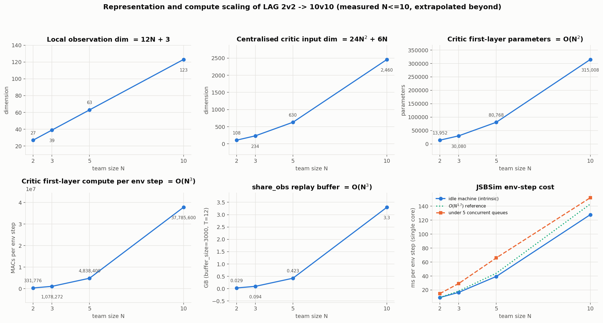
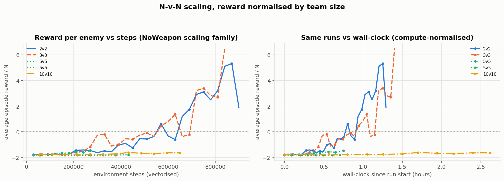
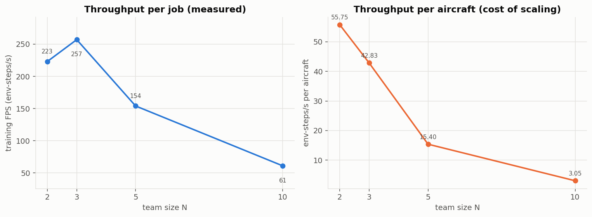
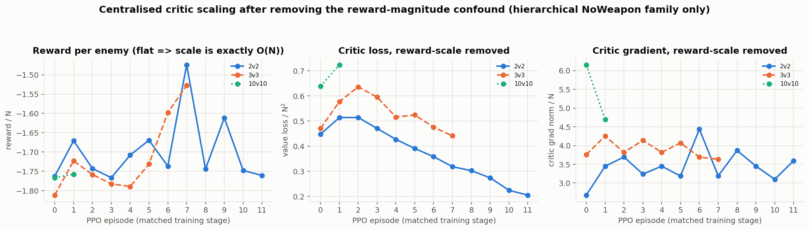
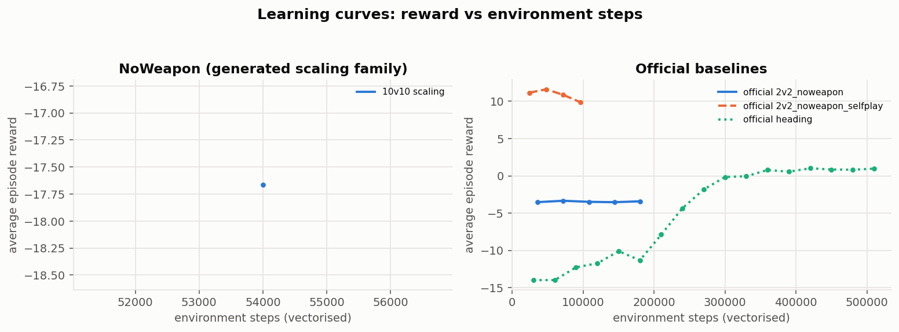

# SRTP 阶段实验进展汇报：LAG 基线复现与多智能体可扩展性初探

负责人：刘酝潇
实验日期：2026-10-3-10-04
服务器：AutoDL，3 × RTX 4090D，48 CPU cores 配额，1 TB RAM
实验分支：`exp/repro-scaling-20261004`（33 个 commit，尚未 merge 到 main）

> 本文是**面向项目组的统一入口**：先读这一份就能了解全局；
> 想看任何细节，第 7 节有完整文档与图表导航。
> 更完整的技术细节见 [完整技术报告](./overnight_repro_scaling_2026-10-04.md)。

---

## 1. 本轮实验目标

本轮做四件事，**目标是 baseline 复现 + 现象刻画（characterization），不是提出新算法**：

- **A** 在新服务器上把 LAG 官方实验链路完整跑通，并把「官方到底提供了哪些实验」审计清楚；
- **B** 把原仓库只支持 2v2 的 `MultipleCombat` 通用化到 **N-v-N**；
- **C** 实测 **2v2 / 3v3 / 5v5 / 10v10** 的可扩展性（计算、墙钟、表示、学习四个层面）；
- **D** 结合老师指定的两篇论文，判断后续 scalable MARL 的可行方向。

---

## 2. 我们具体完成了什么

### 2.1 实验基础设施（让实验可复现、可追踪、可无人值守）

- 补齐了缺失的 **JSBSim 气动数据 submodule**（原仓库克隆后 `data/` 为空，环境完全无法初始化）；
- 验证 conda `jsbsim` 环境（Python 3.12 / torch 2.8.0+cu128 / CUDA 可用 / 3 张 4090D）；
- 建立**统一实验启动器**（逐字复现官方超参数）与**三 GPU 并行任务队列**；
- 全部长任务用 **tmux 后台运行**，每个作业带**墙钟上限**，超时自动轮转到下一个作业；
- 写了**看门狗**（发现未处理异常/进程全停/磁盘不足会立即中止并报警）；
- 自动**指标抽取**（stdout 日志 + 每轮 `metrics.jsonl`）→ CSV/图表/报告表格全部自动生成；
- 建立 `manifest.csv` 与 `status/running_jobs.md`，任何作业都能回溯到命令、种子、GPU、checkpoint。

> **意义**：以后所有实验都可以批量、无人值守地跑，且每一个数字都能追溯到具体命令与提交。

### 2.2 官方 baseline 复现

先做了**严格审计**（详见 [官方实验清单](./baseline_inventory.md)）：
仓库里的「官方实验」分三层——有官方 `.sh` 的 **L1**（6 个训练入口）、
有官方 YAML+task 但无脚本的 **L2**（14 个配置）、以及**根本不存在的 L3**。
本轮**没有把任何自造实验冒充成官方 baseline**。

实际跑通的官方实验（均为官方超参数，`num_env_steps=1e8` 计划值，
因墙钟上限截断，**如实记录完成步数，未偷偷调小预算**）：

| 实验 | 算法 | 完成步数 | FPS | 训练 reward 首→末 | 判读 |
|---|---|---|---|---|---|
| `SingleControl/1/heading` | ppo | 2.46M | 590 | **-14.0 → +100.6** | ✅ **明确学习** |
| `SingleCombat/1v1/NoWeapon/vsBaseline` | ppo | 1.50M | 357 | -208 → **-1.9** | ✅ **明确学习** |
| `SingleCombat/1v1/NoWeapon/HierarchySelfplay` | ppo | 1.14M | 276 | -69 → **+36.8** | ✅ **明确学习** |
| `SingleCombat/1v1/DodgeMissile/HierarchySelfplay` | ppo | 0.90M | 218 | -265 → **-0.4** | ✅ **明确学习** |
| `SingleCombat/1v1/ShootMissile/HierarchySelfplay` | ppo | 0.72M | 172 | -196 → **-21.1** | 🟡 已跑通，早期 |
| `MultipleCombat/2v2/NoWeapon/HierarchySelfplay` | mappo | 1.48M | 208 | -3.53 → **+1.20** | 🟡 已跑通，很慢 |
| `MultipleCombat/2v2/ShootMissile/HierarchySelfplay` | mappo | 1.15M | 163 | -36.9 → **+9.08** | 🟡 已跑通，早期 |
| `1v1/ShootMissile/HierarchyVsBaseline` | ppo | **0** | — | — | ❌ **官方配置本身有 bug，无法运行（见 §4.6）** |

**要点**：`SingleControl` 与 1v1 系列**复现成功且学习明显**；
2v2 MAPPO 系列能跑通、能存 checkpoint、有学习趋势，但**明显更慢**。
**没有**任何实验跑到官方 1e8 步（本次约 1% 量级），因此**不能**声称"完整复现收敛结果"。

### 2.3 N-v-N 通用化

原仓库 `MultipleCombatTask.num_agents` **硬编码 `return 4`**（只支持 2v2）。
好消息是整条流水线（vec-env → buffer → runner → 策略）都从 `envs.num_agents` 推导，
所以**放开这一个属性即可支持任意 N**。我们只改了这一处，**没有改 MAPPO 任何部分**。

新增 7 个生成配置（2v2/3v3/5v5/10v10 noWeapon + 2v2/3v3/5v5 shoot），
reward/termination/simulation 参数**逐字继承官方 2v2 模板**，只替换机队编队。

**一致性验证**：生成的 2v2 与官方 2v2 在 episode 0 的 reward 只差 **0.19%**
（-3.532 vs -3.525），证明 scaling 家族确实锚定在官方基线上。

> ⚠️ 必须声明：**这是工程通用化，不是科研创新。**
> 唯一已知的系统性差异是：为保持机间间距恒定，正面宽度随 N 线性增长
> （2v2 约 0.56 km → 10v10 约 5.0 km），即交战空间随 N 变大。

---

## 3. Scaling 到底看到了什么

### 3.1 计算可扩展性：环境步进成本 ∝ N^1.64

单核实测（随机动作）：

| 规模 | 飞机数 | ms / env-step | 每架飞机 ms |
|---|---|---|---|
| 2v2 | 4 | 9.27 | 2.32 |
| 3v3 | 6 | 16.59 | 2.76 |
| 5v5 | 10 | 39.37 | 3.94 |
| 10v10 | 20 | 127.85 | 6.39 |

最小二乘拟合：**T_env ∝ N^1.64，R² = 0.9989**。

**进一步的逐项拆分为何重要**（这是本次最有价值的定位结果）：

| 组成部分 | 2v2 → 10v10 | 拟合指数 |
|---|---|---|
| `get_obs`（对全部 agent） | 1.98 → 37.18 ms（18.8×） | **≈ N^1.82** |
| **JSBSim 物理仿真** | 3.66 → 15.63 ms（4.27×） | **≈ N^0.90（线性）** |
| `env.step` 总计 | 14.50 → 183.88 ms（12.7×） | ≈ N^1.57 |

> **结论：LAG 在 N-v-N 上的超线性成本，主要不是 JSBSim 物理仿真造成的，
> 而是观测/全局状态构造的工程实现造成的——每步做了两遍完全相同的 O(N²) 工作。**
> 到 10v10 时，观测构造占整个 env step 的 **40%**，物理仿真只占 **8.5%**。
> 这是 `Computational / Representation scalability`，**与 MARL 算法无关**。

*上图横轴为队伍规模 N，纵轴依次为：局部观测维度、集中式 critic 输入维度、
critic 首层参数量、每步 critic 计算量、share_obs 回放缓冲区大小、以及实测 env-step 耗时。
可以看到 critic 侧的量（输入维 O(N²)、计算与内存 O(N³)）增长远快于观测维度；
而最后一个面板显示实测环境成本随 N 超线性（红色为并发负载下的对照）。
**Caveat**：N ≤ 10 为实测，N = 20/50 的 critic 计时也是在本机真实实例化网络测得的，
但 N = 100 为外推。*

### 3.2 墙钟可扩展性：10v10 在同等墙钟下买不到进展

*这是本轮的核心 scaling 主图。纵轴统一为 **reward / N**——因为 LAG 的
`PostureReward` 对每个敌机累加，奖励幅度随 N 线性增长，不归一化就无法跨规模比较
（实测：四个规模在 episode 0 的 reward/N 都是 -1.74 ~ -1.78，验证了归一化的正确性）。
左图为 vs 环境步数，右图为 vs 真实墙钟小时；每条曲线都标注了种子。
**我们看到什么**：2v2、3v3、5v5 都至少有种子冲破了初始平台（爬到 reward/N ≈ +1 ~ +6.5），
**而 10v10 的全部 3 个种子在 2.6 小时墙钟后仍然完全平躺在 -1.7**。
**Caveat**：10v10 的步数（59–65 万）少于 2v2（90 万），且每个规模只有 3–4 个种子；
因此正确表述是"**同等墙钟预算下没有观察到进展**"，
**不是**"10v10 一定学不会"。*

**吞吐对比**（实测）：

| 规模 | 线程 | FPS | 秒/向量步 | 3000 步 rollout 一轮耗时 |
|---|---|---|---|---|
| 2v2 | 10–12 | 186–223 | 0.063 | **约 3 分钟** |
| 3v3 | 8–10 | 126–257 | 0.063 | 约 3 分钟 |
| 5v5 | 10–18 | 92–156 | 0.11 | 约 5–6 分钟 |
| **10v10** | 18 | **57–61** | **0.30** | **约 15–17 分钟** |

同样的墙钟时间，2v2 能跑约 690k 步/小时，10v10 只有约 67k 步/小时——**相差约 10 倍**。

*左图为训练吞吐 FPS 随 N 的变化；右图为「每架飞机分摊到的吞吐」，
即规模的边际成本。单位吞吐的下降说明**规模变大时不是简单地"多花时间"，
而是每架飞机的效率本身在下降**。Caveat：各规模的线程数不同（按实测成本配置），
因此右图的每飞机口径是最公平的跨规模比较方式。*

### 3.3 表示 / 集中式 critic：目前最值得继续验证的信号

当前 MAPPO 的集中式 critic 输入是**全体 agent 观测的拼接**（`24N²+6N` 维），
并且**复制给每一个 agent**。随着 N 增大：观测维度 O(N)、share_obs 维度 **O(N²)**、
critic 每步计算 **O(N³)**、replay buffer 内存 **O(N³)**。

**归一化后的实测结果**（取每个训练前 5 个 episode 的均值，括号内为组内标准差）：

| N | 运行的种子数 | episode 数 | reward/N | **value_loss / N²** | **critic_grad_norm / N** |
|---|---|---|---|---|---|
| 2 | 4 | 20 | -1.748 | **0.479** (0.035) | **3.42** (0.44) |
| 3 | 4 | 20 | -1.762 | **0.584** (0.059) | **3.89** (0.29) |
| 5 | 3 | 15 | -1.775 | **0.643** (0.051) | **4.46** (0.18) |
| 10 | 3 | 15 | -1.739 | **0.704** (0.034) | **5.20** (0.77) |

**在扣除奖励尺度之后，critic 的相对拟合误差与梯度幅度都随队伍规模严格单调上升**
（`value_loss/N²` +47%，`grad_norm/N` +52%），且组间跨度是组内标准差的 3–7 倍。

*左图 reward/N（应当平坦——它平坦就证明归一化是对的，也证明奖励幅度确实 ∝ N）；
中图 value_loss/N²；右图 critic_grad_norm/N。后两者是**扣除了奖励尺度之后**剩下的信号。
**Caveat（必须一并引用）**：
(1) 每个规模只有 3–4 个种子，这里报的组内标准差是**同一训练内 episode 间**的波动，
**不能代替种子间方差**；
(2) 只覆盖训练早期（前 5 个 episode）；
(3) 同一批运行的 PPO `ratio ≈ 1.0000`、策略熵仍处于最大熵的 97–99.8%（见 §4.3），
即 **actor 本身几乎没动**，因此该信号**也可能部分来自"critic 在追一个几乎静止的目标"**。*

### 3.4 种子方差很大（一条必须记住的方法学结论）

同一配置、不同随机种子的最终表现差异**极大**：

| 规模 | 各 seed 的 reward/N | 跨度 |
|---|---|---|
| 2v2 | -0.06 / +1.87 / -0.62 | 2.5 |
| 3v3 | -0.50 / **+6.51** / -1.15 / -0.49 | **7.0** |
| 5v5 | -1.73 / **+1.01** / -0.80 | 2.7 |
| 10v10 | -1.64 / -1.53 / -1.59 | **0.11** |

> **两个必须记住的结论**：
> 1. **单种子的跨规模比较没有意义**——3v3 的种子间跨度（7.0）比任何两个规模之间的差距都大。
>    **今后所有正式的 cross-N 结论必须至少 3 个种子。**
> 2. 值得注意的是，**10v10 是四个规模中种子间方差最小的**（跨度仅 0.11），
>    且三个种子**一致地**停留在初始平台。这种"一致地不动"
>    比"有的种子学到了、有的没有"更值得关注，但**仍不能**据此断言算法层面失效。

### 3.5 学习曲线总览

*各实验的训练 reward 随环境步数的变化（按实验族分面板）。
最直接的读数是：`SingleControl/1/heading` 与 1v1 系列都明显上升，
而 2v2/3v3/5v5/10v10 的 MultipleCombat 家族上升慢得多、且种子间分歧大。
另有按墙钟时间的版本见 [learning_curves_walltime.png](../experiments/2026-10-04-night/figures/learning_curves_walltime.png)。*

---

## 4. 仓库里发现的几个重要问题

以下都是**读代码 + 实测**发现的，与上面的 scalability 结果**性质不同**，必须分开看待。

**4.1「FSP」并不是 FSP。**
`algorithms/utils/selfplay.py` 中 `FSP.choose()` 是
`np.random.choice(list(agents_elo.keys()))`——**对全部历史 checkpoint 均匀随机采样，
完全不使用 ELO**；`FSP.update()` 是空函数，ELO 从不更新
（`share_jsbsim_runner.py:219` 还留着 `# TODO: use eval results to update elo`）。
`PFSP` 因为 ELO 恒等，其 meta-solver 概率也退化为均匀分布。
→ 因此官方脚本跑的 `fsp` 应准确描述为
**「MAPPO + 历史 checkpoint 均匀采样自博弈」**，
**不能**称为博弈论意义上的 Fictitious Self-Play，也**不能**与文献里的 FSP 结果对比。
这是 **upstream 实现/命名问题**，不是 scalability 问题。

**4.2 MultipleCombat 缺乏场景随机化。**
`MultipleCombatEnv.reset_simulators()` 只调用 `sim.reload()`，**不做任何随机化**，
所以**每个 episode、每个 rollout 线程都从完全相同的初始态势开始**；
评估也是确定性的（离线重复评估同一 checkpoint 的标准差为 **0.0**）。
对比之下 `SingleCombatEnv` 会 shuffle 初始状态。
→ 这意味着**泛化性在本次实验中完全没有被测量**；这是 **evaluation/scenario 层面的问题**。
（注意：正确的修法是**随机化初始条件**，而**不是**单纯增加 eval episodes——
后者只是把同一场确定性对抗重复很多遍。）

**4.3 日志中的熵列不能直接跨 N 比较（已修正）。**
`ACTLayer.evaluate_actions` 把每维熵**除以了 batch 行数**再求和，
而 batch 行数随 `n_rollout_threads`（即随 N）变化（2v2 是 7200，10v10 是 10800）。
→ 已用两种方式修正并互相印证（日志还原 vs 直接加载 checkpoint 前向）：
**实测训练数十万步后，策略仍处于最大熵的 95%–99.8%，即接近均匀随机**
（未训练策略为 100%）。这解释了战斗任务学得慢，但**不能**用来断言"学不会"。

**4.4 PostureReward 随敌机数量累加。**
`PostureReward.get_reward()` 对**每个敌机**累加 `orientation × range`，
而所有配置的 `PostureReward_scale` 都是 15.0，
因此**每步奖励幅度 ∝ N**，跨 N 的 raw reward 不可直接比较。
→ NoWeapon scaling 一律使用 **reward / N** 归一化（已被实测验证：
episode 0 的 reward/N 在四个规模上都是 -1.74 ~ -1.78）。
⚠️ 该归一化**只对 NoWeapon 家族严格成立**（shoot 家族还含不随 N 变化的奖励项）。

**4.5 原始 `num_agents` 硬编码为 4。** 属**代码可扩展性问题**，已修（见 §2.3）。

**4.6 发现一个官方配置根本无法运行（真实 upstream bug）。**
场景 `1v1/ShootMissile/HierarchyVsBaseline`（及 `_nolimit`）在第一个 env step 即崩溃：
`HierarchicalSingleCombatShootTask.normalize_action` 在执行
`self._shoot_action[agent_id] = action[-1]` 时，
**还没走到父类的 `use_baseline` 提前返回分支**，而此时对手 agent 的 action 是 `None`。
→ 说明「**有 YAML + 有 task 分支 ≠ 配置可用**」，
这正是本次逐项 smoke test 的价值。详见 [失败记录 F9](./night_failures.md)。

**性质区分**：4.1 / 4.2 / 4.3 / 4.6 属 **upstream 实现或评估协议问题**；
4.4 属**奖励设计与实验方法**问题；**只有 §3.1 的观测构造冗余与 §3.3 的 critic 增长
才属于 scalability 问题**，而其中观测冗余仍是**工程实现**而非算法问题。

---

## 5. 两篇老师论文对我们意味着什么

完整精读见 [两篇论文笔记](./scalable_marl_papers.md)（含 17 行对比表与页码索引）。

**Paper A —《Efficient and scalable reinforcement learning for large-scale network control》**
(Nature Machine Intelligence 2024)：攻击的是**"全局信息/中心化"瓶颈**——
中心化学习要求每个 agent 拥有全局观测，通信与计算成本随之爆炸。
解法是**图局部性**：每个 agent 只依赖其 **κ-hop 邻域** $N^\kappa_i$，
策略局部化 $\pi_i(\cdot\mid s_{N^\kappa_i})$，用 extended value 逼近全局价值，
误差随邻域半径**指数衰减**（Theorem 3：$|V_i(s)-V_i(s^{N^\kappa_i})| \le \frac{r_{max}}{1-\gamma}\gamma^\kappa$），
再叠加局部模型与 branched rollout 提升样本效率。

> **与 LAG 的连接（本轮最有价值的一条）**：
> **当前 LAG 相当于 κ = ∞。**
> `get_obs()` 对每个 agent 遍历**全部** partner+enemy，与图距离无关，
> 于是局部观测维度 `12N+3` 本身就随 N 发散，critic 输入更是 `24N²+6N`。
> 也就是说 **LAG 现在实现的不是"局部观测 + 集中式 critic"，
> 而是"全局观测 + 全局 critic"**。
> 下一步可以直接把邻域改成「k 近邻 / 威胁邻域」做 sweep——
> 这是与实测瓶颈（§3.1 的 O(N²) 观测构造、§3.3 的 critic 增长）对应最直接的方向。
> ⚠️ **现实检验**：$\gamma^\kappa$ 在 $\gamma=0.99$ 时要达到 $0.1\,r_{max}$ 误差需要
> **κ ≈ 700**，所以"小 κ 就够"**绝不能当定理用**，必须经验验证。

**Paper B —《Breaking the Curse of Multiagency in Robust Multi-Agent RL》**：
攻击的是**联合动作空间**的统计瓶颈——样本复杂度经 $\prod_i |A_i|$ 随 agent 数指数增长。
本文在**新提出的一类 robust Markov game** 上把界降到对 $\sum_i A_i$ **线性**。

> **对 LAG 的意义**：**目前只作为思想参考，不打算直接复现 Robust-Q-FTRL。**
> 原因是设定差距不可跨越：Paper B 要求 **tabular 状态 + finite horizon +
> generative model + robust CCE**，而 LAG 是连续高维状态、神经网络策略、
> self-play、非平稳对手。
> 另外必须注意：**MAPPO 的 actor 是 factorized 的，并不显式枚举联合动作**，
> 所以 $\prod|A_i|$ 从一开始就不是 LAG 的计算瓶颈。
> **两篇论文解决的是正交的两件事：Paper A 管"信息"，Paper B 管"统计"。**
> 我们实测到的所有超线性增长**全部落在 Paper A 的坐标系里**。

---

## 6. 下一步研究方向（压缩为三层）

**P0 — 先把实验做扎实（这是前提，不是可选项）**

1. **提高训练预算**：2v2 要到约 **7.5e5 步**才出现明显 reward 抬升，
   而官方预算是 1e8。本次只跑到约 1% 量级。任何"哪个规模更好学"的结论都必须先补预算。
2. **每个规模至少 3 个种子**：§3.4 已证明种子方差足以颠覆结论。
3. **随机化初始条件 + 标准化评估协议**：当前训练与评估都只在同一组确定性初始态势上，
   泛化性完全未测量。

**P1 — 先修最明显的 scalability 瓶颈**

4. **消除重复的观测构造**：`get_state()` 每步把 `get_obs` 对全部 agent 重跑一遍，
   实测耗时与整份观测构造**完全相等**（10v10: 37.18 vs 36.95 ms）。
   同一步内缓存复用即可把观测开销减半。**这是工程修复，必须单独报告，
   绝不可与算法改进混算。**
5. **奖励归一化消融**：把 NoWeapon 的 `PostureReward_scale` 从 15 改为 `15/N`，
   验证 §3.3 的 critic 信号是否由奖励尺度残留造成。**这是对现有结论最直接的证伪实验。**
6. **局部邻域观测实验**：把邻域从"全部"改为"k 近邻 / 威胁邻域"并扫 k，
   直接检验 Paper A 的思想（同时报告 γ=0.99 的 κ≈700 现实检验）。

**P2 — 在实验支撑之后再考虑算法创新**

7. **动态局部 / 稀疏集中式 critic**（与 P1-6 同源，可先做成 critic 侧消融）；
8. **动态交互图 / 分组**（边上由距离、威胁度、目标、导弹威胁决定）；
9. **自适应课程与采样**（含让 self-play 真正使用 ELO）；
10. 长期路线：**model-based 样本效率**（Paper A 的主线，但实现复杂度最高）。

> **不建议现在做**：在观测仍是 O(N²) 全局拼接的情况下先上 attention/graph——
> 那样无法归因收益来自哪里；也不建议把 Paper B 的算法搬到 LAG。

---

## 7. 文档与实验入口

### 7.1 必读（按推荐顺序）

| 文档 | 作用 | 建议什么时候看 |
|---|---|---|
| [本文 group_progress_report_2026-10-04.md](./group_progress_report_2026-10-04.md) | 统一入口：全局进展 + 结论 + 导航 | **先看这份** |
| [完整技术报告 overnight_repro_scaling_2026-10-04.md](./overnight_repro_scaling_2026-10-04.md) | 21 节技术细节：环境、复现、四个层面的 scaling、失败分析 | 需要引用具体数字时 |
| [官方实验清单 baseline_inventory.md](./baseline_inventory.md) | 官方到底提供了哪些实验（L1/L2/L3）、官方脚本的两个缺陷 | 想知道"哪些是官方的、哪些是我们造的" |
| [N-v-N 可扩展性审计 nvn_scalability_audit.md](./nvn_scalability_audit.md) | 20 项代码审计、维度公式、逐项成本拆分、修改清单 | 要改代码或写论文方法部分时 |
| [失败记录 night_failures.md](./night_failures.md) | F1–F9：症状/根因/代码位置/修法/验证/分类 | 遇到类似报错，或答辩被问"踩过什么坑" |
| [两篇论文笔记 scalable_marl_papers.md](./scalable_marl_papers.md) | 精读 + 17 行对比表 + 与 LAG 的接口 | 准备组会/答辩的理论部分 |
| [候选研究方向 scalable_marl_candidates.md](./scalable_marl_candidates.md) | 12 个候选方向 + 证据强度对照表 | 讨论"下一步做什么" |

### 7.2 实验数据入口

| 文件 | 作用 |
|---|---|
| [manifest.csv](../experiments/2026-10-04-night/manifest.csv) | **总账**：每个实验的命令、种子、GPU、步数、FPS、reward、checkpoint 路径、状态 |
| [metrics/report_tables.md](../experiments/2026-10-04-night/metrics/report_tables.md) | 自动生成的报告表格（复现状态 / scaling 对比 / 归一化 critic / 资源占用） |
| [metrics/summary.csv](../experiments/2026-10-04-night/metrics/summary.csv) | 每个实验的单行汇总 |
| [metrics/scaling_table.csv](../experiments/2026-10-04-night/metrics/scaling_table.csv) | **scaling 对比表**（含 wall-clock 归一化、参数、维度、熵、NaN 检查） |
| [metrics/normalized_scaling.csv](../experiments/2026-10-04-night/metrics/normalized_scaling.csv) | 归一化后的 critic 诊断（逐 episode） |
| [metrics/sample_efficiency.csv](../experiments/2026-10-04-night/metrics/sample_efficiency.csv) | 匹配步数处的 reward 对比（含"测量点是否够密"标记） |
| [metrics/curves/](../experiments/2026-10-04-night/metrics/curves/) | 每个实验的逐步学习曲线 CSV |
| [metrics/critic_scaling.json](../experiments/2026-10-04-night/metrics/critic_scaling.json) | critic 网络在 N=2…50 的实测参数/时延 |
| [metrics/obs_cost_profile.json](../experiments/2026-10-04-night/metrics/obs_cost_profile.json) | env-step 成本的逐项拆分 |
| [status/running_jobs.md](../experiments/2026-10-04-night/status/running_jobs.md) | 最后一次运行状态快照 |
| [scripts/](../experiments/2026-10-04-night/scripts/) | 全部工具：启动器、队列、看门狗、指标抽取、绘图、离线评估、熵探针 |
| `scripts/results/`（未入 git，见下） | **原始 checkpoint**（`actor_latest.pt` / `critic_latest.pt`）与 `metrics.jsonl` |

> ⚠️ **checkpoint 与原始日志**：`scripts/results/` 与 `experiments/**/logs/` 已被 `.gitignore`
> 排除（体积原因）。**它们仍完整保留在服务器上**，路径记录在 `manifest.csv` 里。
> 图表 PNG 已纳入版本控制（体积小、报告需要）。

---

## 8. 图表索引

所有图位于 `experiments/2026-10-04-night/figures/`，均由 `make_figures.py` 自动生成。

| 图 | 内容 | 核心用途 | 入口 |
|---|---|---|---|
| `scaling_reward_normalized.png` | **归一化 scaling 主图**（reward/N vs 步数 与 vs 墙钟，含全部种子） | **核心结论**：10v10 在最长墙钟下仍无进展 | [png](../experiments/2026-10-04-night/figures/scaling_reward_normalized.png) |
| `throughput_vs_agents.png` | FPS 与每飞机摊薄 FPS 随 N | 墙钟效率下降 | [png](../experiments/2026-10-04-night/figures/throughput_vs_agents.png) |
| `critic_normalized_scaling.png` | reward/N、value_loss/N²、grad_norm/N | **表示/优化层面信号** | [png](../experiments/2026-10-04-night/figures/critic_normalized_scaling.png) |
| `scaling_dimensions.png` | obs/share_obs/critic 维度·参数·计算·内存 + env 成本 | 表示与计算规模增长（含 N=20/50 实测） | [png](../experiments/2026-10-04-night/figures/scaling_dimensions.png) |
| `learning_curves_steps.png` | 各实验 reward vs 环境步数 | 学习曲线总览 | [png](../experiments/2026-10-04-night/figures/learning_curves_steps.png) |
| `learning_curves_walltime.png` | 同上，但横轴为墙钟时间 | **计算归一化**视角：谁更"划算" | [png](../experiments/2026-10-04-night/figures/learning_curves_walltime.png) |
| `resource_scaling.png` | 每作业 CPU 核数、RSS、显存随 N | 资源需求（显存恒 <1.9 GB，GPU 不是瓶颈） | [png](../experiments/2026-10-04-night/figures/resource_scaling.png) |

**关键资源实测**：训练进程峰值合计 **41 核 / 48 核配额**；峰值内存 **38.4 GB / 1007 GB**；
峰值显存 **1.84 GB / 24564 MB**。→ **GPU 全程远未饱和，本项目真正的资源货币是 CPU 核 × 时间。**

---

## 9. 结论边界（FACT / OBSERVATION / HYPOTHESIS / NEXT STEP）

**✅ FACT（已实测、可复现）**

- N-v-N 工程扩展**可行**：2v2/3v3/5v5/10v10 全部能跑、能存 checkpoint、无 NaN、无崩溃；
  生成的 2v2 与官方 2v2 差异仅 0.19%。
- 官方 `SingleControl/heading` 与 1v1 系列**复现成功且学习明显**
  （heading: -14.0 → +100.6，2.46M 步）。
- 环境步进成本 **∝ N^1.64（R²=0.9989）**，其中 **JSBSim 物理是线性的（N^0.90）**，
  超线性来自**观测构造**；10v10 时观测构造占整个 env step 的 **40%**。
- 训练吞吐随 N 明显下降：2v2 约 690k steps/h，10v10 约 67k steps/h（**约 10 倍差距**）。
- centralized critic 的诊断量在**扣除奖励尺度后仍随 N 严格单调上升**
  （value_loss/N² 0.479→0.704；grad_norm/N 3.42→5.20）。
- 官方所谓 FSP 实为历史 checkpoint 均匀采样；MultipleCombat 训练/评估均无场景随机化；
  `PostureReward` 使奖励幅度 ∝ N；`1v1/ShootMissile/HierarchyVsBaseline` 官方配置无法运行。

**🔍 OBSERVATION（观察到但样本有限）**

- 10v10 的三个种子在 59–65 万步、最长墙钟下**一致地停留在初始平台**，
  而 2v2/3v3/5v5 各有种子突破平台。
- 训练数十万步后策略熵仍处最大熵的 95–99.8%（接近均匀随机），PPO `ratio ≈ 1.0000`
  ——**critic 在学，actor 几乎没动**。
- 种子间方差极大（3v3 跨度 reward/N = 7.0），足以颠覆单种子的跨规模结论。

**❓ HYPOTHESIS（尚无充分证据）**

- 集中式 critic 的相对拟合难度随 N 上升，是表示/优化层面的可扩展性瓶颈
  （需更多种子 + 更长训练才能确认）。
- 10v10 的"一致地不动"可能反映算法层面的可扩展性退化
  （但也可能只是步数不足或几何构型差异）。

**➡️ NEXT STEP**

- P0：补预算、补种子、随机化初始条件与标准化评估；
- P1：消除重复观测构造、奖励归一化消融、局部邻域（κ-sweep）实验；
- P2：在实验支撑后再考虑动态局部 critic / 交互图 / 自适应采样。

**❌ 目前没有证明（请勿在答辩或论文中写成结论）**

- ✗「MAPPO 在 10v10 一定学不会」
- ✗「curse of multiagency 已被严格验证」
- ✗「局部 critic 一定优于全局 critic」
- ✗「某个创新算法已经成立」

---

*本报告由 `docs/` 与 `experiments/2026-10-04-night/` 中的落盘产物自动汇总生成；
所有数字均可通过 `experiments/2026-10-04-night/manifest.csv` 追溯到具体命令、种子与 commit。*
